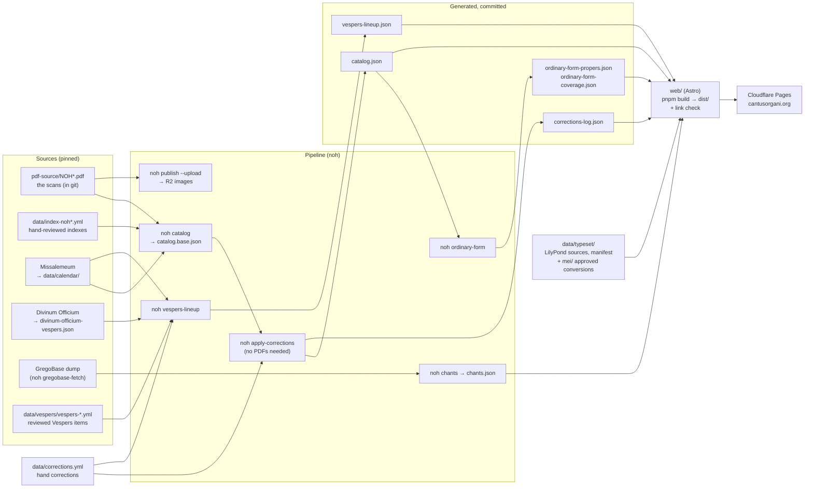

# How Cantus Organi fits together

Sources go through the pipeline (Python, `noh`) to data files in git, and the
site (Astro, static) is built from those files. Corrections are an overlay on
the data, never edits to generated files. For how to fix things, see
[EDITING.md](EDITING.md); for what to run after a change and how it reaches the
site, [OPERATIONS.md](OPERATIONS.md).

## The parts

| Part | Where | What it does |
|---|---|---|
| **Pipeline** | `pipeline/` (`uv run noh …`) | Reads the scans (`pdf-source/`, in git), splits pages into systems, reads the printed indexes and the calendar, and writes the data files. A catalogue rebuild also reads `data/published/` and `data/ocr/margins/`, so it gives the same result anywhere; only uploading images needs the R2 keys. |
| **Data** | `data/` | Reviewed inputs (`index-*.yml`, `vespers/vespers-*.yml`, `rubrics-1962.yml`, `corrections.yml`, `ordinary-form/*.yml`, `good-friday.json`), vendored sources, and generated outputs (`catalog*.json`, `vespers/vespers-lineup.json`, `chants.json`, `corrections-log.json`, `ordinary-form-*.json`). The generated outputs are committed, so the site builds from git alone. |
| **Site** | `web/` | A static Astro site built from `data/`. `pnpm build` ends by crawling `dist/` and fails if any page can't be reached by a link. Page images come from R2 (`images.cantusorgani.org`). |
| **Admin API** | `web/functions/admin/` → `web/src/lib/admin/` | Pages Functions behind Cloudflare Access (a signed-in email on the `EDITORS` list; `auth.ts`): the corrections queue, editors' own fixes, and publishing a batch. |
| **GitHub webhook** | `web/functions/api/github/webhook.ts` | Tells the admin API what happened to a batch (see [A correction's journey](#a-corrections-journey)) and releases typeset previews. |
| **Corrections Worker** | `workers/corrections/` | Takes readers' reports from the Corrections form (Turnstile, Origin allowlist) into D1, at `api.cantusorgani.org`. The rate limit is a count of D1 rows (5 per hashed submitter), and `CORRECTIONS_ENABLED` is its kill switch. Its migrations are the database schema, shared with the admin API. |
| **CI** | `.github/workflows/site.yml` | On every pull request that changes more than Markdown: the typeset render (and, for same-repo pull requests, upload to R2), then secret scan, lint, pipeline tests, Ordinary Form coverage, corrections applied, typeset checks (`--remote` except on fork pull requests), chant notation current, type check, site and Worker tests, stale MEI report, build and link check, both browser suites (site and export editor). Separate jobs run the LilyPond tests and, when `pipeline/`, `tests/`, scan inputs or dependencies change, the slow scan tests. On `main`: the same, then deploy; the deploy waits for the typeset render and upload. See [OPERATIONS.md](OPERATIONS.md#checking). |
| **Publishing** | `.github/workflows/corrections-batch.yml` | Runs when the admin screen publishes: for typeset source edits, a sandboxed `source-check` job first; then records the batch (`noh correct-batch`), rebuilds the chant notation, regenerates the typeset manifest and the Ordinary Form files, and opens a pull request as the GitHub App. |
| **Rebuilding** | `.github/workflows/catalog-rebuild.yml` | Run by hand from the Actions tab: rebuilds a volume's catalogue from the scans after an index edit, on a branch or as a pull request. |
| **Review queue** | `data/review-queue.json` → `/admin/review/` | What `noh catalog` was unsure of. The admin screen lists it, less what is confirmed (`reviewed` corrections, in `data/reviewed.json`) or settled by the data (`web/src/lib/admin/reviews.ts`). A confirmation holds the item's fingerprint and lapses when a rebuild changes the item. |
| **Typeset music** | `data/typeset/`, `pipeline/typeset/` | The volunteers' LilyPond transcriptions: matched to parts (`noh typeset-match` → `parts.yml`, by page, file name and melody against GregoBase), listed in `manifest.json`, drawn by LilyPond in the site workflow and uploaded to R2 under `typeset/<hash>/`. See [TYPESETTING.md](TYPESETTING.md). |
| **Typeset source editing** | `web/src/lib/admin/typesetApi.ts` (`/admin/api/typeset/{source,draft,approve,preview}`), `typesetStore.ts`, `typesetPreview.ts`; `.github/workflows/typeset-preview.yml`; D1 migrations 0006–0008 | Editors fix a LilyPond file on `/admin/typeset/`: a private draft, a preview drawn on GitHub, then an approved edit that publishes as a correction. |
| **Ordinary Form calendar** | `pipeline/ordinary_form.py` (`noh ordinary-form`), `data/ordinary-form/`, `web/src/lib/ordinaryForm*.ts`, `web/src/pages/ordinary-form/[key].astro` | Projects Graduale Romanum (1974) assignments over the existing catalogue, reusing its scans and typeset music; adds no pieces. Operations: [OPERATIONS.md](OPERATIONS.md#ordinary-form-calendar-and-accompaniments); coverage: [ORDINARY-FORM-MUSIC-COVERAGE.md](ORDINARY-FORM-MUSIC-COVERAGE.md). |
| **PDF export** | `web/src/lib/pdf.ts`, `exportParts.ts`, `exportSelection.ts`, `web/src/workers/pdf.worker.ts` | The basic export: the scan images of chosen parts, joined into a PDF in the browser (pdf-lib). |
| **Customize export (MEI/Verovio)** | `pipeline/typeset/mei/` (`noh typeset-mei-*`), `data/typeset/mei/`, R2 `mei/<sha256>/`, `web/src/lib/export-layout/`, `web/src/workers/export-layout*.worker.ts` | Approved conversions of typeset parts reflow in the browser to the reader's page size, then export to PDF. Chant is set in the same export (`export-layout/chant*.ts`, `exportChants.ts`, `exsurgeLoader.ts`). Stale approvals are listed in admin (`admin/exportPaused.ts`). See [TYPESETTING.md](TYPESETTING.md#custom-export-mei). |
| **MEI workflows** | `.github/workflows/mei-conversion.yml`, `mei-stale.yml` | `mei-conversion`: run by hand; converts typeset sources and, if asked and on the default branch, uploads the conversion artifacts that match existing approved records (it does not create or commit records). `mei-stale`: on a push to `main` that touches typeset sources, includes or the converter, reports which approvals went stale and tries to carry them forward; it commits nothing. |
| **Good Friday** | `data/good-friday.json` → `noh chants` → `web/src/pages/good-friday/`, `web/src/lib/goodFriday.ts` | A chant-only page for both calendars: NOH sets nothing for the day, so each chant is named by its GregoBase id. |
| **R2 check** | `.github/workflows/r2-check.yml` | Run by hand after setting or rotating the R2 secrets. See [ADMIN-SETUP.md](ADMIN-SETUP.md). |
| **Typeset cleanup** | `.github/workflows/typeset-prune.yml` | Run by hand: deletes renders on R2 that nothing names, keeping anything recent. |
| **Images** | `.github/workflows/publish.yml` | Run by hand from the Actions tab: slices the PDF pages named, uploads their images to R2, and rebuilds that volume's catalogue so it names them; on a branch or as a pull request. |

## A correction's journey

1. A reader reports it (Corrections form → Worker → D1), or an editor makes it
   (admin screen → D1).
2. An editor accepts it on `/admin/`, then **Publish changes**. The admin API
   asks GitHub to run `corrections-batch`.
3. The workflow runs `noh correct-batch`: it checks each entry against the data
   and records it in `data/corrections.yml` with the value it replaces
   (`was`). Then `noh apply-corrections` rewrites the generated files, and the
   workflow opens a pull request.
4. The site workflow checks the pull request. Most batches merge themselves
   when it passes (`gh pr merge --auto`), and the merge deploys. A batch waits
   for the owner when `hold_reasons` fires (`pipeline/corrections.py`): it
   moves systems between pieces, or has 25 or more non-review changes.
5. GitHub's webhook tells the admin API what happened. Merged: the reports are
   accepted, with the merge commit. Closed unmerged: editors' rows return to
   approved, readers' reports to review (a twin of a pending report becomes
   `duplicate`). The site check failed on the batch branch: the rows return to
   approved and the pull request is closed (best effort: a failed close is logged). The `corrections-batch` run
   itself failed: the rows return to approved.

What a correction can name: `piece:<slug>` (title, incipit, mode, genre,
printed pages), `part:<slug>/<part>` (where it starts, its chant) and
`vespers:<office>/<item>` (tone, chant). The rules for each field live in one
file, `data/schema/corrections.json`, read by the pipeline, the admin API and
the Corrections form.

## Which day is it?

The calendar (`data/calendar/`, from Missalemeum) gives each date its
celebration keys (`tempora:Pent18-0`, `sancti:12-25m3`, …). The pipeline
decides which office a date keeps, and which key names it. For Vespers that is
each lineup day's `observance`, so the site looks titles up rather than
working them out. `normal_key` (dropping a resumed Sunday's `r` or a Christmas
Mass's `m1`–`m3`) is the one rule both sides share, for matching a day page to
its Vespers.

## Which page is it?

Each volume's page map (`data/derived-offsets.json`, from `noh offset
--segments`) turns printed pages into PDF pages. NOH3 also binds two addenda
(Queenship of Our Lady and St Pius X, both 1954) that number their pages
afresh. `data/volumes.yml` declares them under `addenda`, and each gets its own
page-map segment with a `pagination` id. An index entry printed in one names
that id, and so does its piece, so the site reads "Addenda ad Partem III,
pp. 3–11". A page reference in a rubric ("Pars III, p. 5") always means the
body. The addenda are printed faintly, so their staves are found with the
settings under "faint print" in `pipeline/segment.py`.

## Where the code is

- `pipeline/catalog.py`, `parts.py`: pieces, and the Proper parts within them.
- `pipeline/indexextract/`: reading a printed index (`table.py`), matching its
  entries to headings and the calendar (`matching.py`), reading pages
  (`pages.py`), proposals and their checks (`proposals.py`), and catalogues read
  from the body's headings (`headings.py`).
- `pipeline/vespers/`: each date's Vespers, in the order sung: `calendar.py`
  (Easter, seasons, Marian antiphons), `reviewed.py` (the reviewed files, with
  their corrections), `music.py` (each item's systems, tone-bank formula or
  note), `lineup.py` (the lineup), `proposal.py` (Magnificat antiphons read
  from the scans). `vesperitems.py`: aligning texts to the scans (proposals for
  review). Both packages re-export every name, so `from pipeline.vespers import
  …` still works.
- `data/sections/`: a Proper's sections as a person checked them, applied with
  the hand corrections (`pipeline/sections.py`). A row with a `key` keeps its
  name when rows around it change; a key that is a movement's name
  (`gloria`) moves that movement.
- `pipeline/index.py`: the index entries. Besides page, title and days, an
  entry may carry a `reference` (its Mass is printed elsewhere),
  `reference_sources` (the cited Masses, with parts to `omit`), `pagination`
  (printed in an addendum) and `no_music` (a rubric only, below its page's last
  system).
- `pipeline/volumes.py`: `data/volumes.yml`: per-page staff-finder settings
  (`staff_finder`), inserted leaves (`inserts`, "162 bis"), addenda.
- `pipeline/typeset/`: importing, matching (`match.py`, `melody.py`: words and
  melody against GregoBase, with the repeats written out), the manifest,
  rendering and publishing of the typeset music; `mei/`: converting it to MEI
  for the Customize export.
- `pipeline/ordinary_form.py`: the Ordinary Form resolution and its coverage
  check. `pipeline/chants.py`: `chants.json`, including the Good Friday chants;
  `pipeline/hymnpairings.py`: `hymn-pairings.json`.
- `web/src/pages/chant/[id].json.ts`: one chant's notation as JSON, for the
  export. `web/public/_headers`: the site's security headers. Page-view
  analytics are GoatCounter (`Layout.astro`, `exportAnalytics.ts`).
- `scripts/regenerate.sh`, `scripts/check.sh`: the regeneration order and the
  pull request's checks, for running by hand.
- `data/vespers/`: the reviewed Vespers files, the lineup and the vendored
  Vespers sources.
- `pipeline/corrections.py`: the overlay (`noh correct`, `apply-corrections`,
  `correct-batch`); system ranges apply first, and every other correction
  counts from them; `where.py`: `noh where`.
- `web/src/lib/admin/`: the admin screen; `scans.ts` picks the systems shown
  beside a correction, from `/admin/scans.json`.
- `web/src/lib/`: catalogue, calendar, Vespers and admin code, each with its
  tests beside it.
