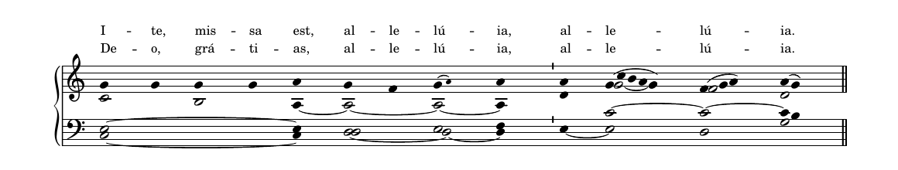

# Catalogue lyrics above the chant staff — 2026-10-12

Correct every lyric row across all 859 nonempty catalogue sources. This changes 718 LilyPond files: 714 single-row sources and four Ite scores with a response row previously below the bass staff. The other 141 sources already create every Lyrics context above the GrandStaff. Both Ite rows use named contexts declared before the staves. Every musical note, word and manual musical line break is retained; the inverse context-only edit restores original source content exactly.

All 718 changed scores were rendered in narrow SVG, wide SVG, Letter PDF and A4 PDF. 702 succeeded in all four formats. The other 16 fail with exactly the same errors when rendering their unmodified source backups; `baseline-failures.json` contains the comparison. No source was marked broken or altered to silence an existing notation error. The typeset manifest/review hashes were regenerated, and the 648 affected melody-audit rows were recomputed with identical musical findings.

The full MEI catalogue was reprocessed under profile 3 after the source edits, using the normal automatic approval pipeline and 13 production layouts per approved conversion. Counts remain 777 approved, 41 needing review, 25 failed and 16 unsupported out of 859. Every approved score.mei is byte-identical to its prior conversion. Lyrics already specify place="above"; fresh SVG baseline checks confirm rendered placement above their chant staff.

611 of the 708 committed matched approval records were refreshed by copying the generated records, with no hand-edited digests. The other 97 remain current. All 708 records pass current-input, artifact and target/render checks; there are no manifest exclusions and 1,416 verified publication object keys. See `approval-verification.json`. The live MEI manifest is unchanged: publication and its manifest release follow after this PR merges, subject to the P6 resource measurement gate.

The upstream contribution is [CMAA PR #8](https://github.com/CMAA/nova-organi-harmonia/pull/8), directed to master as requested. It includes 724 upstream lyric corrections (the six original OT28 scores plus this patch) and the inherited expanded catalogue, since CMAA master has not merged those volumes. Existing upstream CRLF line endings are retained. Local transcription overrides remain intact.

Validation commands: `noh typeset-check`, `noh typeset-mei-stale --fail-on-stale`, the publisher bundle and manifest gates, the regenerated SVG lyric audit, `pytest -m 'not slow'`, and a production site build with CI public variables. Results are recorded in `validation.json`.

The Ite Ib extraction snapshot was regenerated from the pinned listener. Its only changes are `lyrics:#0/#1` becoming the two explicit context names; all musical events, lyric text, onsets and locations are identical.

The original anonymous-context fixture is retained separately, and the context-separation test now covers both anonymous and named rows.

CI publication follow-up: the first render job drew 701 scores but rejected `co_fili_quid_fecisti` against the editor-selected St John communion (correction c-0029). Its original page-based match had no numeric confidence; the retarget's existing 0.547 agreement fell below the default 0.85 threshold. Pinned listener evidence independently proves all 110 notes and 32 words identical before and after the layout edit. The generated target-specific baseline includes original-source and GABC digests. Publication, previews and source-correction refresh now resolve baselines by exact source and target; GABC changes invalidate it, unrecorded retargets keep 0.85, and degraded music is rejected. The matching-regression tests passed red before the fix and green afterward; 43 publisher/preview/source-batch checks passed. No converter or MEI digest was changed by this follow-up.

Release decision (2026-10-12): the user chose to defer the additional P6 resource measurement and proceed using the existing export limits, and authorized upload and merge after green CI and live artifact verification.
