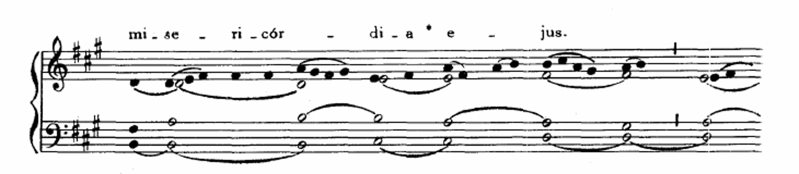

# Deferred MEI recovery evidence

The user approved original printed NOH scans as the authority for faithful source corrections. Target promotion requires complete melody and printed identity agreement, with accepted editor assignments preserved. Ambiguous notation and musical variants remain deferred; lyric overlap remains an informational warning.

This branch represents hidden, untied zero-time voice-line endpoints as silent hidden grace anchors. Their normalized duration remains zero, they cannot form a timed chord, and visible zero-duration notes are rejected. Original breaks may meet a voice-line end anchor; strict interior breaks and new user breaks remain unsafe. Pinned Verovio tests cover both system and page breaks.

## Source corrections

[Correction provenance](source-corrections.json) identifies the original printed passage and before/after source hashes. Five sources have narrow corrections: Domine refugium's malformed G token, Haec dies's misplaced octave marker, Oravi's mistyped octave comma, Te gloriosus's cue sizing plus two tied F3 tenor notes, and Regina mundi's stale printed-page comment. No uncertain octave or duration was guessed.

## Editorial queue

The [baseline source inventory](../2026-10-12-export-p5/deferred-coverage.md) accounts for all 151 original deferred sources. Detailed [matching audit](deferred-match-audit.md), [source triage](deferred-source-triage.md), and [layout audit](deferred-layout-audit.md) distinguish editorial work from converter defects.

The fresh [Regina mundi comparison](regina-fresh-comparison.md) supersedes the old perfect interval score. A seasonal Alleluia accounts for ten additional GABC notes. The remaining duplicate is the source's printed tied B4 pair versus GABC's repeated same-pitch heads. After those two scan-confirmed normalizations, all 98 notes agree in both diatonic and chromatic pitch; [exact comparison evidence](regina-normalized-melody-evidence.json) is retained. Fresh target and rendering checks precede promotion. The explicit editor assignment for co_exiit_sermo / co_fili_quid_fecisti is preserved.

Fresh catalogue reconciliation is complete: {'approved': 797, 'failed': 18, 'needs-review': 42, 'unsupported': 2}; 727 current eligible records with zero exclusions. All 708 published MEI files and boundaries are unchanged. [Final source-level coverage](final-coverage.md) records the recovered sources and remaining decisions. Publication follows the code PR merge.

Te gloriosus has an [exact full-sequence comparison](te-gloriosus-melody-evidence.json): 142 written pitches agree in both diatonic and chromatic pitch after the marked Alleluia repeat is expanded; eight tied continuations yield 134 physical attacks. Its printed identity and target collision checks also pass.

## Verification

- All 859 sources converted and rejudged from frozen inputs; 727 current eligible approvals, no stale records and no manifest exclusions. Existing 708 published MEI bytes and boundary maps are unchanged.
- 2,155 non-source, non-LilyPond Python checks passed; 23 real pinned-LilyPond checks passed. Two temporary-write sandbox failures passed when rerun with worktree access. Ruff and source checks pass.
- All 1,504 web tests passed. Astro reports zero errors and warnings; the production build passed all 1,734 page links and fixture checks.
- All four compilable corrected sources rendered in narrow SVG, wide SVG, Letter PDF and A4 PDF. Oravi remains blocked by its unresolved df token.
- All 797 approved conversions retain lyrics above their staff across 18,212 rendered pages and 638,079 lyric positions, with zero below-staff or missing-evidence findings.
- Independent converter and integration reviews are clear. The public MEI manifest remains at 708 entries pending code merge, publication and live verification.

The local typeset uploader received no credentials from the 1Password pipe. The existing PR workflow can upload the four newly rendered LilyPond asset sets before its remote checks; no new MEI object was uploaded at this stage.
