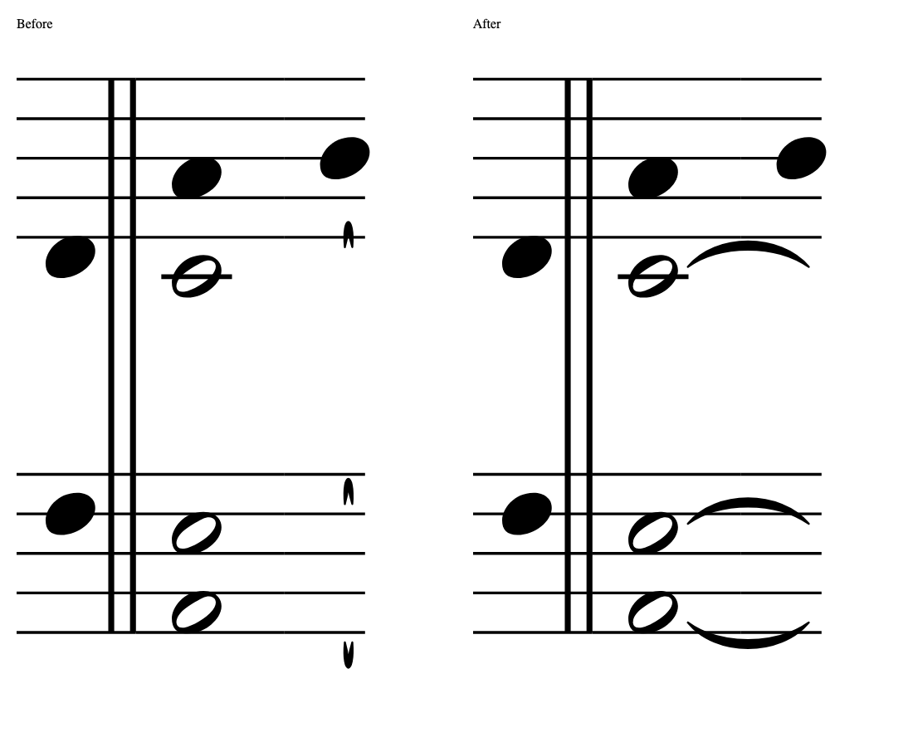

# P5 layout residuals and deferred coverage

Generated outgoing split ties previously attached to a hidden fragment rather than the visible note. On Gloria IX, iPad mini automatic layout, system 3, the outgoing pieces were only 0.34 mm long and looked like stray marks. Following the predecessor chain to its nearest visible head produces 5.51 mm arcs. Only generated split-tie start references change; explicit ties, continuation fragments, end-of-system positions and pagination remain unchanged. Missing or cyclic predecessor chains retain their existing endpoint.

The real-render regression failed before integration and passes afterward. The 19-piece catalogue matrix, hidden-continuation tests and explicit-tie tests passed (41 baseline tests). Existing word-boundary correction fixtures already pass; remaining unavoidable breaks retain D24 informational diagnostics. No speculative word-break algorithm change was added.

The fresh `in_exsurge` and `co_video_caelos` large-staff endpoints also pass existing tolerance: tie start is 360 SVG units from the head origin, below the 451.333-unit limit. Added tests accept that geometry while rejecting displaced, wrong-height and missing tie pieces. No tolerance broadening was justified.

The user chose nonblocking lyric-spacing advice. Precheck version 7 consumes existing real-font `lyricGaps` measurements and reports pairs below 0.3 mm as `info: lyrics:`. Automatic approval still ignores informational advice and blocks other findings. Existing published approvals and conversion artifacts are not rewritten.

## Deferred coverage

[Full source-level audit](deferred-coverage.md) and [machine-readable inventory](deferred-coverage.json) account for all 151 deferred sources: 69 approved conversions without site target matches and 82 with technical or source findings. The inventory uses saved catalogue evidence; it does not constitute new approval.

[Focused fresh layout results](deferred-layout-rerenders.json) re-rendered all 13 layouts of the seven layout-only deferred sources using their saved MEI and the current layout code. All seven still have blocking findings: five tie-rendering cases and two clipping cases. This confirms follow-on work is required; the P5 split-tie attachment correction alone does not make these sources publishable. No full-catalogue rerun, source correction or approval/publication was performed.

## Validation

Python full non-slow suite: 2,184 passed, 4 skipped, 125 slow tests deselected, 1 expected failure. Ruff passes. Astro typecheck: zero errors and warnings. Existing 708 published approvals remain current. Full web suite: 1,502 tests passed across 101 files. Production build, all 1,734-page internal links, and no-fixture checks passed.
