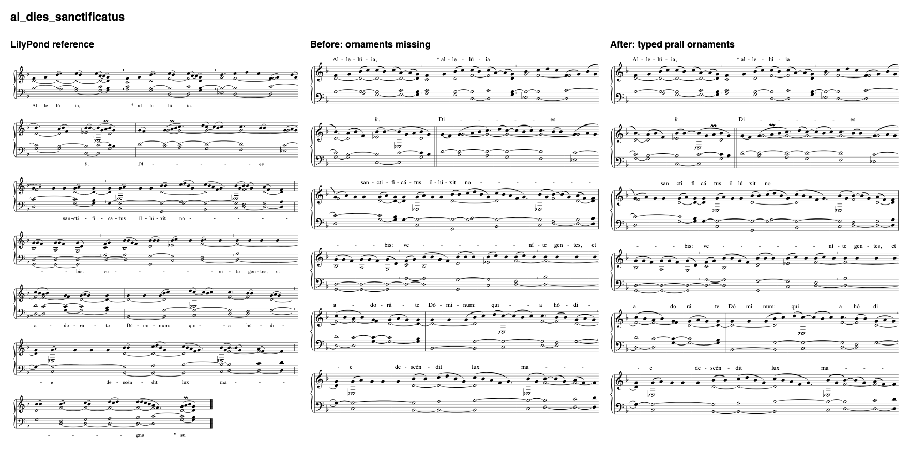
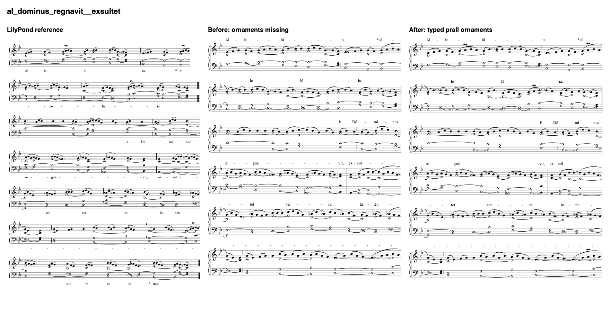

# P1 + P2 conversion evidence — 2026-10-12

Implements [the brief](../../plans/2026-10-12-p1-prall-brief.md) against main `fbda6ba`.
The parked `7fe46d5` changes were reviewed and ported rather than cherry-picked because the extractor
also needed the P2 changes. The event-only articulation listener was replaced after review showed
that it missed chord-local scripts and ignored resolved second-voice direction.

## Converter behavior

- LilyPond Script acknowledgements carry resolved direction into an `Ornament` IR field. MEI uses
  `<mordent form="upper" type="prall" startid="#…" staff="…" place="above|below">`.
- Quilisma remains the untyped upper mordent over a hidden head. The oracle distinguishes typed
  ornaments by kind, form, attached source event, staff and placement; drop, move and type mutations fail.
- Profile `accompaniment-v1` is version 3. Unconverted ornaments (including accent) and ambiguous chord
  ornaments still raise `UNKNOWN_FEATURE`. A prall with a unique note attachment no longer blocks approval.
- Precheck requires a real drawn glyph for every encoded mordent in every required layout; an empty SVG
  ornament group does not pass.
- Tie targets match the next attack's same pitch, including every tied chord member. The encoder uses IR
  spans rather than choosing its own adjacent note. An intervening rest, skip or unmatched attack stops a tie.
- Note-local chord ties are also extracted, preserving only the tied member.

## P2 fixtures

All five named vol-1 pieces now match the independent semantic oracle:
`of_ad_te_domine`, `gr_dirigatur_oratio_mea`, `of_deus_enim`, `of_exsulta_satis`, `gr_salvos_fac_nos`.
The `gr_dirigatur_oratio_mea` chord retains both c-to-c and e-to-e ties. The other four sources have
malformed chant tie starts; they retain `UNKNOWN_FEATURE` warnings and cannot be auto-approved.
No source transcription is changed.

## Sample

The deterministic sample is the first 30 sorted vol-1 sources containing `\prall` (listed in
[sample-sources.txt](sample-sources.txt)). This is a bounded coverage demonstration, not a random catalogue estimate.
Baseline uses a frozen copy of main. Both sides use real LilyPond, the independent schema/oracle,
13 production Verovio layouts, precheck and automatic review.

| State | Before | After |
|---|---:|---:|
| approved | 0 | 29 |
| needs-review | 29 | 0 |
| failed | 1 | 1 |
| unsupported | 0 | 0 |

The unchanged failure is `al_excita_domine.csv.ly` (non-positive duration), already tracked under P3.
Every successfully converted sample piece loses its unconverted-prall approval blocker.
The converter's nonzero batch exit reflects that source failure, not a failed verification suite.

```sh
uv run noh typeset-mei-batch --sources build/p1-sources.txt \
  --out build/p1-final --workers 2 --auto-approve
```

Raw [before](sample-before.json) and [after](sample-after.json) batch reports accompany this file. Approved sample records stay under ignored `build/`;
this PR does not publish them or change the committed conversion records or manifest. Converter changes
stale approvals as expected; the coordinator handles carry-forward or re-judging.

## Visual comparison

Viewed LilyPond and production MEI output for `al_dies_sanctificatus`,
`al_dominus_regnavit__exsultet`, `al_beatus_homo`, and `al_confitemini_domino`.
The pralls attach to the same chant notes, above the top staff. Explicit below, second-voice default,
and Script override directions are additionally covered by pinned-LilyPond integration regressions.
The images show the reference, main's missing ornaments, and the fixed conversion. Lyrics above the
staff are the existing export profile's choice.





## Verification

- Python: `uv run pytest -q -m "not slow"` passed: 2,163 tests; 4 skipped, 125 slow deselected, 1 expected failure.
  Five existing PyMuPDF/SWIG deprecation warnings remain.
- Lint: `uv run ruff check pipeline tools tests` passed.
- Web: `pnpm test` passed, 100 files / 1,498 tests.
- Web: `pnpm typecheck` passed, 0 errors / 0 warnings (10 existing hints).
- All five Missa IX MEI and boundaries are byte-identical to frozen main.
- Fresh review found two important ornament issues, reproduced with real LilyPond before fixing:
  neutral Script direction and missing chord-local Script acknowledgement. Both regression groups pass.
  Review also exposed the note-local chord tie omission; its failing regression now passes.
- Deferred minor: the `DROPPED_COMMANDS` introductory comment still describes the old listener.

## Rulings

- Ported the reviewed WIP patch instead of cherry-picking over shared extractor edits. Cost if wrong:
  the port must be compared with `7fe46d5`; the final listener intentionally replaces its event-only hook.
- Left other ornaments and ambiguous chord ornament attachments in `UNKNOWN_FEATURE`. Cost if wrong:
  conservatively lower coverage until a mapping and attachment are verified.
- Included note-local chord ties in P2 after review found silent loss in an existing source. Cost if wrong:
  additional listener rows must retain single-pitch semantics; the regression checks only the tied member.
