# Page templates

This is the catalogue of every page template on Cantus Organi as it stands on 2026-10-22. It records what each page shows, what it remembers and what it does when data is missing, so a redesign can check that nothing is lost.
Design tokens, user journeys, must-keep features and accessibility have their own files: [tokens.md](tokens.md), [journeys.md](journeys.md), [must-keep.md](must-keep.md), [accessibility.md](accessibility.md).
Paths are from the repository root. Page counts come from `data/` (method in the last column of the notes under each heading).

| id | route | file | pages | key components |
|---|---|---|---|---|
| home | `/` | `web/src/pages/index.astro` | 1 | Layout |
| division | `/<division>/` | `web/src/pages/[division]/index.astro` | 6 | PieceList, VespersDates |
| day | `/day/<flex>/<name>/` | `web/src/pages/day/[flex]/[name].astro` | 466 | PieceList, PartLinks, ExportBar |
| piece | `/piece/<slug>/` | `web/src/pages/piece/[slug].astro` | 558 (+18 redirects) | SystemStack, MovementNav, ExportBar, TypesetSwitch, RecordStatusNotice, ChantPair |
| piece-scans | `/piece/<slug>/` (scan view) | same as piece | 0 (a view) | SystemStack, TypesetSwitch |
| piece-export | `/piece/<slug>/#customize-export` | `web/src/components/ExportLayoutEditor.astro` | 0 (a dialog) | ExportLayoutEditor, ExportPagePreview |
| piece-chant | `/piece/<slug>/` (chant on) | same as piece | 0 (a view) | MovementNav, SystemStack |
| vespers | `/vespers/<date>/` | `web/src/pages/vespers/[date].astro` | 468 | VespersPage, LineupStack, ExportBar |
| vespers-first | `/vespers/<date>/i/` | `web/src/pages/vespers/[date]/i.astro` | 110 | VespersPage, LineupStack, ExportBar |
| kyriale | `/kyriale/` | `web/src/pages/kyriale/index.astro` | 1 | PieceList |
| kyriale-mass | `/kyriale/<n>/` | `web/src/pages/kyriale/[mass].astro` | 18 | SystemStack, MovementNav, ExportBar |
| ordinary-form | `/ordinary-form/<key>/` | `web/src/pages/ordinary-form/[key].astro` | 193 | SystemStack, MovementNav, ExportBar |
| calendar | `/calendar/` | `web/src/pages/calendar/index.astro` | 1 | (inline script) |
| calendar-of | `/calendar/ordinary-form/` | `web/src/pages/calendar/ordinary-form/index.astro` | 1 | (client in `web/src/lib/ordinaryFormCalendarClient.ts`) |
| good-friday | `/good-friday/` | `web/src/pages/good-friday/index.astro` | 1 | (chant notation only) |
| hymns | `/hymns/` | `web/src/pages/hymns/index.astro` | 1 | Layout |
| search | `/search/` | `web/src/pages/search.astro` | 1 | Pagefind |
| corrections | `/corrections/` | `web/src/pages/corrections/index.astro` | 1 | (form + queue) |
| corrections-log | `/corrections/log/` | `web/src/pages/corrections/log/index.astro` | 1 | Layout |
| about | `/about/` | `web/src/pages/about.astro` | 1 | Layout |
| not-found | `/404` | `web/src/pages/404.astro` | 1 | Layout |
| admin (6 screens) | `/admin/...` | `web/src/pages/admin/` | 6 | AdminNav |

Other files in `web/src/pages/` are not templates: `chant/[id].json.ts` (chant data for the in-browser notation), `corrections/targets.json.ts`, `admin/review.json.ts`, `admin/scans.json.ts`, `admin/typeset/context.json.ts`, and `e2e/[page].astro` (test only; built only with `E2E_TEST_PAGES=1`).

## Shared chrome

Every page uses `web/src/components/Layout.astro`. Its props are `title`, `description`, `skipTo` and `noindex`.

- **Head.** Title is `<title> — Cantus Organi` (the home page is just `Cantus Organi`). It also sets the canonical URL, Open Graph and Twitter tags (image `/social-card.png`), a favicon, and JSON-LD (`WebSite` and `WebPage`). JSON-LD is left out on noindex pages.
- **Noindex.** Set by the `noindex` prop or by `indexablePath()` in `web/src/lib/seo.ts`. That covers `/admin/*`, `/api/*`, `/search/`, `/corrections/` and `/404`. Admin pages get `noindex, nofollow`; the others `noindex, follow`. `<main>` carries `data-pagefind-ignore` on these pages so the site search skips them.
- **Early script (head).** Reads `localStorage` `scan-polarity` (`normal` or `inverted`) and `typeset-view` (`scans`) and sets `data-scan-polarity` and `data-view` on `<html>` before first paint. Storage errors are swallowed.
- **Skip link.** `Skip to music` (`.skip-link`) is drawn only when the page passes `skipTo`. Pages that do: piece, kyriale-mass, ordinary-form, vespers, vespers-first, good-friday. It targets `#music`, `#initium` or `#chants`.
- **Nav bar** (`.nav`, hidden when printing). Brand link `Cantus Organi` to `/`; then `Extraordinary Form (1962)` (`/calendar/`), `Ordinary Form` (`/calendar/ordinary-form/`), `Search`, `About`, `Corrections`, and the **Invert** button. Below 44rem the two form links shorten to `EF (1962)` and `OF` (their `aria-label` keeps the full name). There is no current-page marker on the public nav.
- **Invert button** (`#polarity`, `aria-pressed`). Toggles light and dark for the page and its music. With no stored choice it follows `prefers-color-scheme`. A click stores `scan-polarity` in `localStorage`. Token details are in [tokens.md](tokens.md).
- **Footer** (`.footer`, hidden when printing). One line: source credit, `Sources and attributions` (`/about/#sources`), `Report an error` (`/corrections/`), `AI discovery guide` (`/llms.txt`).
- **Analytics.** A GoatCounter script (`cantusorgani.goatcounter.com`) loads on every page. Export clicks are also counted by `web/src/lib/exportAnalytics.ts`.
- **Print.** `base.css` hides `nav`, `.no-print`, `.skip-link` and all buttons in `@media print`. Pages print as plain music.
- **Common conventions.** Crumb line (`p.crumb`) at the top of the title block, `h1`, optional Latin `lede`, then a `meta` line. Search has neither a crumb nor a metadata line. Interface text carries class `ui`; Latin carries `lang="la"` or class `la`.

Shared building blocks used below:

- **ExportBar** (`web/src/components/ExportBar.astro`). Described once under *piece*. Used on day, piece, kyriale-mass, ordinary-form, vespers and vespers-first.
- **SystemStack** (`web/src/components/SystemStack.astro`). The music itself: scanned systems, or LilyPond drawings with a scan behind them. Described under *piece*.
- **PieceList** (`web/src/components/PieceList.astro`). A list of links: name, a quiet subtitle (label and title, minus repeats), printed pages. With `numbered` it leads with the Roman numeral.
- **ReportLinks** (`web/src/components/ReportLinks.astro`). `Report · Edit` beside a part. `Report` goes to `/corrections/?target=...`; `Edit` goes to `/admin/edit/?target=...` (editors only; no check on the public page).
- **ChantText** (`web/src/components/ChantText.astro`). A `
` named `Chant text · Latin` with the sung words, rendered only when text exists for the part.
- **DisclosureCue** (`web/src/components/DisclosureCue.astro`). The chevron in every `
`.

---

## home

`/` — `web/src/pages/index.astro` — 1 page.

**Purpose.** First stop: choose a calendar or a book.

**Regions, top to bottom**
1. Shared nav.
2. Title block (`.prose`): `h1` Cantus Organi and a two-sentence description.
3. Two calendar cards (`nav.calendar-links`, `aria-label="Choose a liturgical calendar"`): `What is sung today in the Extraordinary Form?` to `/calendar/`; `What is sung today in the Ordinary Form?` to `/calendar/ordinary-form/`.
4. `The books` list (`ul.divisions`). First a `Hymns` card with the count `hymnIndex().length settings`. Then one card per division that has pieces: English name, Latin name, blurb, `N pieces`. Data: `DIVISIONS` and `divisionsWithContent()` in `web/src/lib/indexes.ts`, over `allPieces()`.
5. Footer.

**Interactive behaviour.** None on the page itself.

**States**
- A division with no pieces is not linked. It is named in a quiet line: `Still to be catalogued: ...`, plus `N pieces are available now` (`pending.length > 0` branch). Today all seven divisions have pieces, so the line does not show.
- The Kyriale card links to `/kyriale/` (its own template), not to `[division]`.

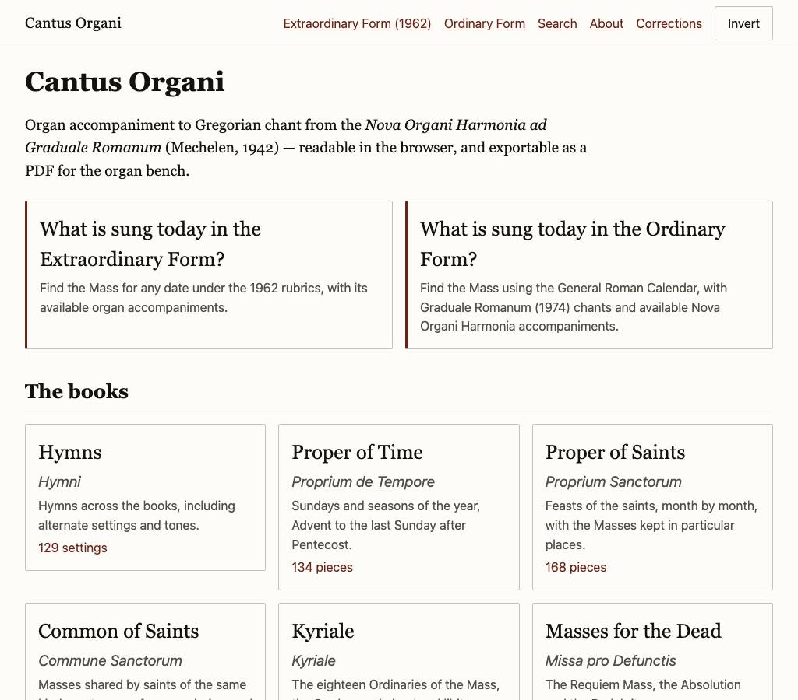
Other views: [390 light](screenshots/home-390-light.jpg) · [1024 dark](screenshots/home-1024-dark.jpg)

---

## division

`/<division>/` — `web/src/pages/[division]/index.astro` — 6 pages. Count: the divisions in `data/catalog.json` with at least one piece, minus the Kyriale (temporale 134, sanctorale 168, commune 25, defunctorum 3, vesperale 55, varia 148 pieces). Slugs: `proper-of-time`, `proper-of-saints`, `commune`, `pro-defunctis`, `vespers`, `varia`.

**Purpose.** Browse one book of the NOH by season, month, or section, and reach a day or piece.

**Regions**
1. Shared nav.
2. Title block: crumb `Cantus Organi`, `h1` (English name), Latin name as `lede`, blurb.
3. Vespers only: `VespersDates` (`web/src/components/VespersDates.astro`) headed `Vespers by date, in the order sung`, with 6 coming evenings.
4. Proper of Time: one `h2` per season (`SEASON_LABELS`), each a list of day links (title, Latin title) from `temporaleIndex()`.
5. Proper of Saints: one `h2` per month (English and Latin), each a list of days with a date number (`last Sun.` for the last Sunday of October), from `sanctoraleIndex()`. A saint's day is listed here even when its Mass is from the Common.
6. `In the 1962 calendar`: days the calendar keeps with a Mass of this book (`communeDays()`; the Saturdays of Our Lady).
7. `Also in this book`: pieces the day lists above did not reach (`PieceList`). No piece is left unlinked.
8. Other divisions: one `h2` per `piece.section` with a `PieceList`.
9. Vespers only: `Hymni / Hymns` A–Z (`ul.hymns`), each linking to the office that prints it (`pieceHref(...)#anchor`) with the piece title beside it.

**Interactive behaviour.** `VespersDates` has an inline script that reads the reader's local date and copies the next `upcoming` evenings (`li[data-date] >= today`) into a visible list. No storage.

**States**
- No scripts: the coming-evenings list stays `hidden`; the `Every date (N)` disclosure (all dates grouped by year) still works.
- No future Vespers dates: the coming list stays hidden.
- A division with no pieces has no route (comment in `getStaticPaths`).

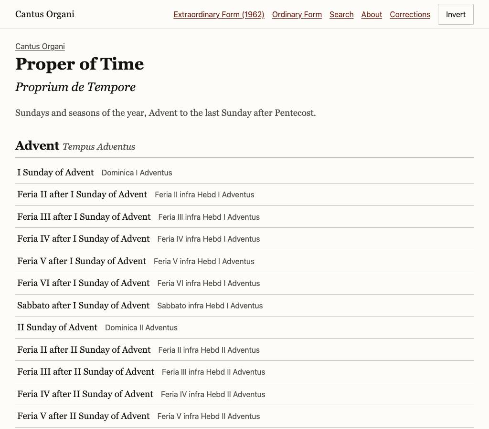
Other views: [390 light](screenshots/division-390-light.jpg) · [1024 dark](screenshots/division-1024-dark.jpg)

---

## day

`/day/<flex>/<name>/` — `web/src/pages/day/[flex]/[name].astro` — 466 pages. Count: distinct calendar keys across `piece.days` in `data/catalog.json` (`catalogedDays()` in `web/src/lib/indexes.ts`). An empty `flex` becomes `feria`.

**Purpose.** For one liturgical day: the Mass Proper, the suggested Ordinary, and Vespers, with a PDF export of the Mass.

**Regions**
1. Shared nav.
2. Title block: crumb `Cantus Organi · Calendar`; `h1` (English title from `observance(key)`, else the raw key); Latin title as `lede`; `meta` line: rank (`classLabel`), liturgical colours, and `next on <long date>` linking to `/calendar/?date=...` (from `findNextDate`).
3. `Proper`: `PieceList` of the Mass pieces for the day, then `PartLinks` (`web/src/components/PartLinks.astro`): per piece, a row of links to each part (Introit, Gradual, ...) on the piece page, borrowed parts marked, plus a `Chant` link to jgabc.
4. `Ordinary` (`section.ordinary`): link to the suggested `Missa <n> — <incipit>`, then `Kyriale heading: "..." (for <date>)` and any note. Chosen by `kyrialeFor(observance, date)`.
5. `Vespers` (`section.vespers`). Either (a) the dated lineup: a console line (`consoleLine`), the Magnificat antiphon, a link to the full Vespers page, and `I Vespers, the evening before` if there is one; or (b) a `PieceList` of the Vesperale pieces, with `NOH VIII does not print the full order of Vespers for this day.` on Sundays.
6. `Hymns for the Office` (`section.office-hymns`): extra Book VII hymn settings from `hymnSettingsForDay()`, and a link to `/hymns/`.
7. `ExportBar` for the Proper plus the suggested Ordinary, titled `<day> with Missa <n>`, with the season and date so defaults fit (no Tract in October).
8. Footer.

**Interactive behaviour.** Only the ExportBar (see *piece*). The defaults for ticked parts follow the season of the date shown. Nothing is remembered here beyond the ExportBar's paper size.

**States**
- No Proper pieces: the `Proper` block is omitted.
- Ordinary: if `suggestion.mass` matches no catalogued Mass, plain text `Missa X or Y` or `No single Mass is assigned`.
- A piece that only lends parts to the day's own Proper is not listed whole (the `lenders` filter).
- No dated Vespers lineup and no Vesperale pieces: no Vespers block.
- The page shows no music. It links to the piece pages.

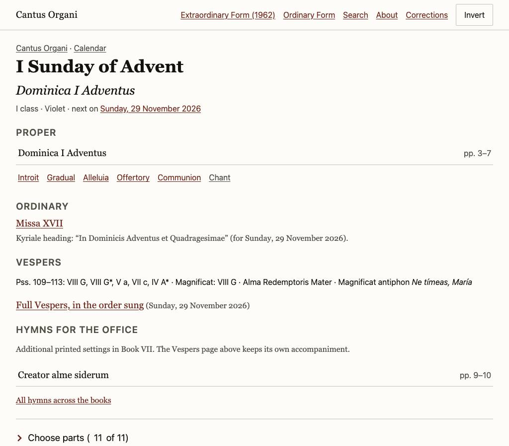
Other views: [390 light](screenshots/day-390-light.jpg) · [1024 dark](screenshots/day-1024-dark.jpg)

---

## piece

`/piece/<slug>/` — `web/src/pages/piece/[slug].astro` — 558 pages. Count: 576 pieces in `data/catalog.json`, minus the 18 Kyriale Masses (`genre: mass_ordinary` with a `mass` number), whose `/piece/` address returns a 301 to `/kyriale/<n>/` (`Astro.redirect`). Old merged addresses are in `web/public/_redirects`.

**Purpose.** Read, play from and export one piece, Proper, hymn or other, from the scanned NOH page.

**Regions**
1. Shared nav and skip link (`Skip to music`).
2. Header (`header.head`): crumb `Cantus Organi · <section>`; `h1` (incipit, else title); `meta`: label, title (if incipit differs), `printed pp. ...`, `N systems` (adds `shown below` when music comes from a referenced piece).
3. Notices (`.notice`): `RecordStatusNotice`; `sourceNote`; the `reference` notice with links to where the music is printed; `Chant for the whole Proper` (jgabc link).
4. Vesperale pieces and hymns only: a notice and `VespersDates`, pointing to the dated pages.
5. `MovementNav` (`web/src/components/MovementNav.astro`): a `Jump to` row (label is `Movements`, `Parts of the Proper` or `Hymns`), parts printed elsewhere shown as `Label → Lender, p. N`. Then, if any part has chant notation, the checkbox `Show the chant with each part` (see *piece-chant*).
6. For Book VIII pieces with related hymns: an `aside.notice` `Related hymn settings in Book VII`.
7. **ExportBar** (`web/src/components/ExportBar.astro`).
   - `Choose parts (N of M)` disclosure with one checkbox per part and its system count; hidden when there is one part.
   - A defaults note.
   - Buttons `Export PDF (N systems, ~P pages)` and `Customize export`.
   - Select `Paper` (Letter or A4).
   - A progress bar and a live status line.
8. `HymnChantLinks` (`aside.notice`): research notes on unverified GregoBase pairings of a hymn.
9. `TypesetSwitch` (`web/src/components/TypesetSwitch.astro`): the `Show the scans` button and a note, only when the piece has typeset music.
10. **SystemStack** (`id="music"`): see below. A piece that cites several sources gets one stack per source under an `h2`.
11. `ChantPair` (`web/src/components/ChantPair.astro`): the `Chant` section, shown only when no part heading already carries a chant link and the piece has no hymn pairing.
12. Edit line: `Report an error` (`/corrections/?target=piece:<slug>`) and `Edit (editors)` (`/admin/edit/?target=piece:<slug>`).

**SystemStack in detail**
- Each part gets a heading (`h2.movement-heading`) with the printed label (`2. Grad. I · In sole posuit`), a `Chant` or `GregoBase` link, `Report · Edit`, an optional Latin rubric with translation, `ChantText`, and `Music from <source>`.
- Each system is an `img.system` in a slot sized to its aspect ratio, scaled against the widest system so relative lengths match the book. Images are WebP at 1x and 2x, lazy after the first two.
- Typeset segments (`div.typeset-segment`): a LilyPond SVG (wide and narrow variants), `Report a music error`, the line `Typeset, proofread` or `Typeset, not yet proofread`, `from the volunteers' transcription`, and the button `Show the scan`.
- Screen readers get a `figcaption.sr-only` that says the music is images and cannot be read.

**Interactive behaviour**
- *Export, quick* (`web/src/components/ExportBar.astro` script). Ticking a part updates the count, the button label and validation (`validateSelection`, `estimatePages` in `web/src/lib/pdf.ts`). `Export PDF` starts the worker `web/src/workers/pdf.worker.ts`, shows `Preparing…` then `Building PDF — system X of Y`, then downloads `<title>.pdf` and reports `PDF ready — N systems, P pages, S MB.` Typeset parts go in as typeset pages unless the reader is looking at the scans.
- *Paper size.* `localStorage` key `export-paper` (`letter` or `a4`).
- *Customize export.* Lazy-loads the editor on click (button shows `Opening…`). See *piece-export*.
- *Typeset and scans.* Page-wide switch: `localStorage` key `typeset-view` (`scans` or `typeset`); sets `data-view` on `<html>`. Per-part `Show the scan` sets `data-show` on that segment for the visit only; the page-wide button clears these. Scripts: inline in `TypesetSwitch.astro`, `Layout.astro` and `SystemStack.astro`.
- *Chant notation.* See *piece-chant*.
- *Keyboard.* Native only: tab order follows the regions above; the skip link jumps past the notices to the music.

**States**
- `piece.status !== "verified"` (80 of 576 pieces): `Catalogued, not yet verified.` notice with a reassurance that the images are not in doubt and a link `Something here is wrong` (`web/src/components/RecordStatusNotice.astro`).
- `sourceNote` set: its text as a status notice.
- `piece.reference` set (the book says "see another Mass"): a notice quoting the reference and linking the pieces that print the music; when it resolves, those pieces' systems are shown below.
- No systems and no reference or source note (76 pieces have no systems): notice `No music of its own.` with the printed page.
- Borrowed part with no resolved systems: `the book refers to <volume>, printed page N. The exact music systems for this reference have not yet been identified.`
- A system image fails to load: its slot gets `data-state="error"` and a message `System N of M could not be loaded. The rest of this piece is shown below.` (a missing bar must never be silent).
- Typeset drawing fails to load: the segment switches to its scan and the note reads `The typeset music could not be loaded; the scan is shown`.
- ExportBar: no parts means no bar. Selection refused means both buttons disabled, with the reason in the status line. `Tick at least one part` when none is ticked. Worker error shows the message in the status line. Editor fails to open: `Can't open the layout editor. Try again, or use Export PDF.`
- ChantPair: no pairing gives `No chant has been matched to this accompaniment yet.`; unverified gives an `Unverified pairing.` notice; missing movements list `Suggest a chant`.

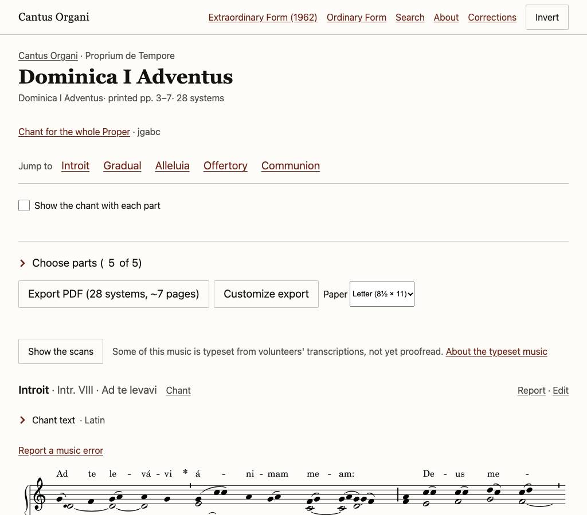
Other views: [390 light](screenshots/piece-390-light.jpg) · [1024 dark](screenshots/piece-1024-dark.jpg)

---

## piece-scans

The *piece* page with the scans shown instead of typeset music. Not a separate route. 0 pages.

**Purpose.** Let the organist play from the printed page when the typeset transcription is not trusted.

**Regions.** Same as *piece*. In this view each typeset segment hides its drawing and shows its `.scans` systems. The `TypesetSwitch` button reads `Show the typeset music` and has `aria-pressed="true"`.

**Interactive behaviour**
- The page-wide button writes `typeset-view=scans` to `localStorage` and sets `data-view="scans"` on `<html>` before paint (Layout head script), so there is no flash. Switching dispatches a `typeset-view` event so every segment relabels its button.
- A part's own `Show the scan` / `Show the typeset music` button overrides the page for that part (and for any copy of the same part on the page, matched by `data-typeset-key`).
- Export follows what the reader sees (`showsScans()` in `ExportBar.astro`): a part shown as scans goes into the PDF as scans.

**States**
- Piece with no typeset music: no switch is drawn, the page is always scans.
- Drawing failed to load: scans are forced for that segment and its own button is hidden.

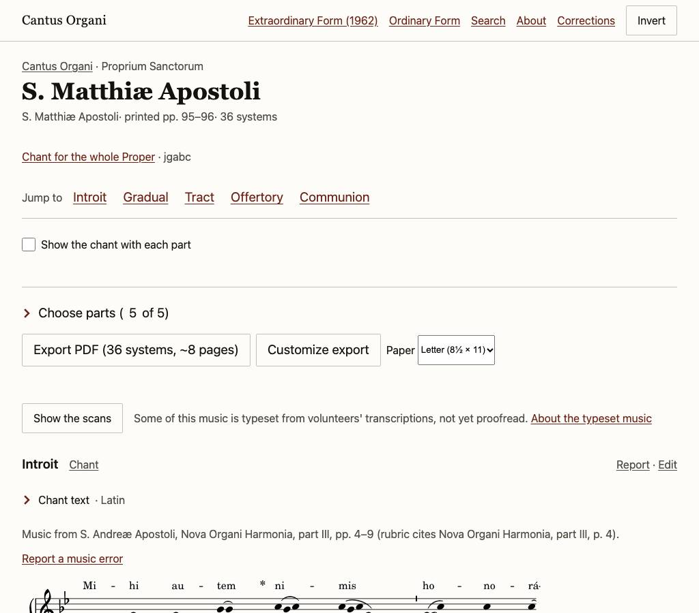
Other views: [390 light](screenshots/piece-scans-390-light.jpg) · [1024 dark](screenshots/piece-scans-1024-dark.jpg)

---

## piece-export

The `Customize export` dialog on a *piece* page (also on day, kyriale-mass, ordinary-form and the Vespers pages). Not a route. 0 pages. Markup: `web/src/components/ExportLayoutEditor.astro`; preview scaffold: `web/src/components/ExportPagePreview.astro`; behaviour: `web/src/scripts/exportLayout.ts` and `web/src/scripts/exportPagePreview.ts`; line-break editor: `web/src/scripts/exportBreakEditor.ts`; logic: `web/src/lib/export-layout/`; copy: `web/src/scripts/exportLayoutCopy.ts`; styles `web/src/styles/exportEditor.css`, `exportPreview.css`.

**Purpose.** Lay out a PDF for a given page size (print or iPad), staff size and line breaks, and download it.

**Regions** (a modal `<dialog>`, cloned from an inert `<template>` on first open)
1. Header: `h2 Customize export`, the selection title, `Close`.
2. `Fit` fieldset: `Music size` (Small, Medium, Large with staff heights in mm), `Systems per page` stepper (`As many as fit`), a result line, and a `Settings` button (narrow screens).
3. Settings panel (`aside`, a side panel from 40rem, a bottom sheet below that):
   - `In this PDF`: list of parts.
   - `Page`: Print / iPad / Custom tiers; Letter, A4, A5; iPad mini, 11-inch, 13-inch; custom width and height in mm or in; Portrait / Landscape; margins stepper (3–25 mm).
   - `Breaks`: `Line breaks` Original or Fit to page, `Each part starts on a new page.`, and `Choose where systems break` (break editor mode with a `Done` bar).
   - `Chant`: Off, Before each part, Chant only.
   - `More options` disclosure: `Sung text size`, `Space between systems`.
4. Preview (`ExportPagePreview`): toolbar with View (Pages or Continuous), Zoom (−, %, +, `Fit width`), `Updating preview…`; below it the page frames.
5. Footer: live status, `Undo`, `Reset layout`, `Cancel` (while exporting), `Download PDF`.
- Two columns from 62rem (settings left, preview right); a single column with a sticky Fit strip below that.

**Interactive behaviour**
- Opening: `history.pushState` adds `#customize-export`, `dialog.showModal()` focuses the title. A stale `#customize-export` in a loaded URL is removed and never opens the dialog. Browser Back closes the dialog. On close, focus returns to the `Customize export` button.
- Keyboard: Esc closes the dialog (or, with the settings panel open below 62rem, closes only the panel); Ctrl or Cmd+Z undoes; the break editor handles Arrow keys, Home, End and Esc (`exportBreakEditor.ts`).
- Remembered: `localStorage` `export-layout-v2` (all settings). The old `export-paper` key is read once as a fallback.
- Heavy code (Verovio, workers `web/src/workers/export-layout.worker.ts` and `export-layout-pdf.worker.ts`, pdf.js, fonts) loads only when the dialog opens. Parts with an approved MEI conversion reflow; the others are placed as they are.

**States**
- `Loading the layout tools…` in the status line while the controller starts.
- No part in the PDF is customizable: `Music size and line breaks apply only to customizable typeset. None of the parts in this PDF are.`
- Chant: `None of the parts in this PDF has a chant.`; `Not used for chant only.`
- Custom page size out of range: inline error text (`CUSTOM_ERRORS`).
- Storage blocked: `This browser isn't saving site settings, so your choices will reset when you leave.` Saved settings unreadable: `Your saved export settings couldn't be read, so the defaults are used.`
- Stale break choices: a dismissible notice in the Breaks group.
- Layout diagnostics (crowded lines, too large, and so on) appear through `copyFor()` messages.
- An approved conversion that no longer matches the published music falls back to fixed typeset or scans. Customize export remains available.
- Printer advisory when margins are under `PRINT_MARGIN_ADVISORY_MM`.

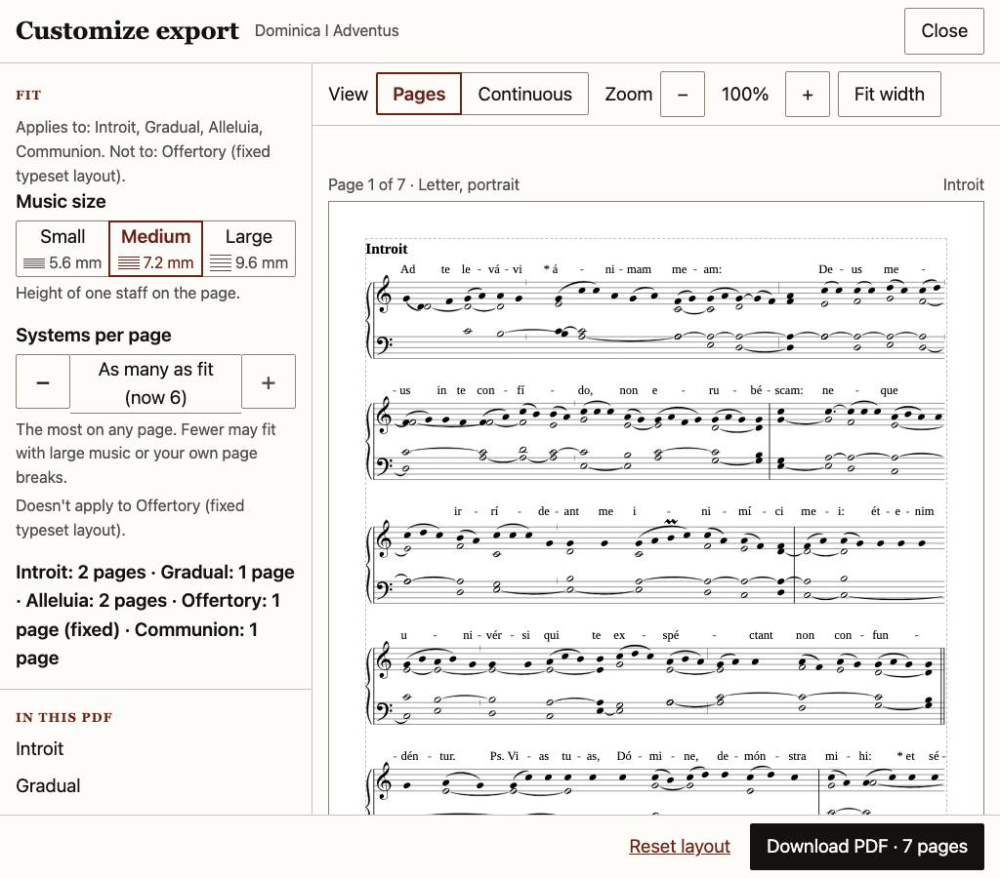
Other views: [390 light](screenshots/piece-export-390-light.jpg) · [1024 dark](screenshots/piece-export-1024-dark.jpg)

---

## piece-chant

The *piece* page with `Show the chant with each part` switched on. Not a route. 0 pages. Script: `web/src/scripts/chantNotation.ts` (`initChantNotation`), preference helpers in `web/src/lib/gabc.ts`, Exsurge loader `web/src/lib/exsurgeLoader.ts`, vendored library `web/public/vendor/exsurge/`.

**Purpose.** Show the Gregorian melody above each part of the accompaniment, drawn in the browser.

**Regions.** As *piece*, plus a `.chant-notation` box under each part heading (annotation and mode, then the staff, then `Chant from GregoBase`). The switch is the checkbox in `MovementNav` and appears only if some part has notation (`hasNotation()` over `data/chants.json`).

**Interactive behaviour**
- Off by default; the page is the organ score. The preference is `localStorage` key `chant-display` (`show` or `link`).
- Boxes are drawn when they come within 800px of the viewport (IntersectionObserver), at the box width up to 900px; a resize redraws after 250ms. Chant data is fetched from `/chant/<id>.json` and cached.
- The same switch pattern is used on `vespers`, `vespers-first` (label `Show the chant with each antiphon and hymn`) and the admin typeset queue. On `good-friday` every box is drawn with no switch (`always`).

**States**
- Draw or fetch fails: the box gets `data-state="error"` and the text `The chant could not be drawn here; the Chant link beside the heading opens it on GregoBase.`
- Chant link beside the heading (`GregoBase`/`Chant`, opens a new tab) is present with the switch off or on.
- No notation for a part: no box; only the link.
- `ChantPair` below the music is replaced by the per-heading links when any heading has one.

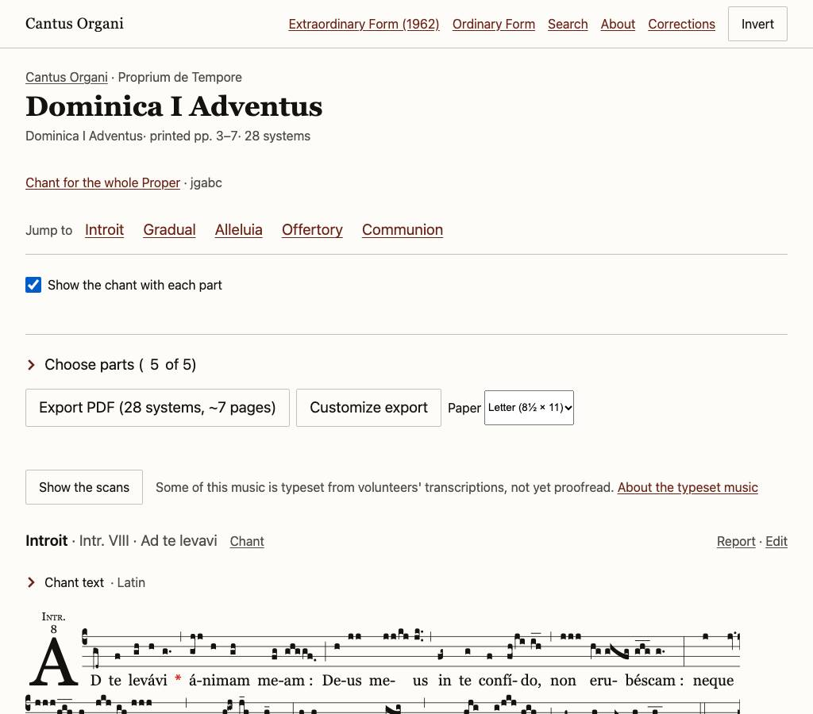
Other views: [390 light](screenshots/piece-chant-390-light.jpg) · [1024 dark](screenshots/piece-chant-1024-dark.jpg)

---

## vespers

`/vespers/<date>/` — `web/src/pages/vespers/[date].astro`, body in `web/src/components/VespersPage.astro` — 468 pages. Count: entries in `days` of `data/vespers/vespers-lineup.json` (II Vespers of each date, 2025 onward; on the Vigil of Christmas, that evening's I Vespers of Christmas).

**Purpose.** Sing or play a whole Vespers in order for one date, from the opening versicle to the Marian antiphon.

**Regions**
1. Shared nav and skip link (`#initium`).
2. Title block: crumb `Cantus Organi · Calendar · <day>` (the day link goes to `/day/...`); `h1` day title; `lede` Latin title `· ad Vesperas`; `meta` `II Vespers · <date> · 1962 rubrics · Nova Organi Harmonia VIII`; a `console` line (`consoleLine(day)`); a quiet notice when tomorrow is a I class feast and this evening's Vespers are its I Vespers.
3. `nav.order` (`aria-label="Order of Vespers"`): anchor links to each section.
4. The chant switch `Show the chant with each antiphon and hymn` (only if the day has notation).
5. `LineupStack` (`web/src/components/LineupStack.astro`, `id="music"`): per section (`h2`), per item (`h3`): `Chant` link, `Report · Edit`, `ChantText`, provenance line (`bankNote`), notes (commemoration, printed text), links to other Book VII hymn settings, the scanned systems (one scale for the whole page), a `Continue every verse to this formula in <tone>, then Gloria Patri.` line, and a `The text of <psalm>` disclosure with the verses.
6. `ExportBar` with segments in sung order (`exportLineup(day)`).

**Interactive behaviour.** Chant switch (see *piece-chant*). ExportBar. `LineupStack.astro` sets `data-state="error"` on a failed system slot and shows `System N of M of [item] could not be loaded.` The `nav.order` links are plain anchors.

**States**
- `item.repeat`: the item has no chant box and no report link (it repeats an earlier one).
- Item source of type `note`: shows the note (for example `Commemoration (...): its antiphon, versicle and prayer are said.`).
- No systems for an item (tone not printed): the heading and note only; the About page says such items are marked to be sung unaccompanied or improvised.
- Psalm with `psalmText`: a disclosure; otherwise none.

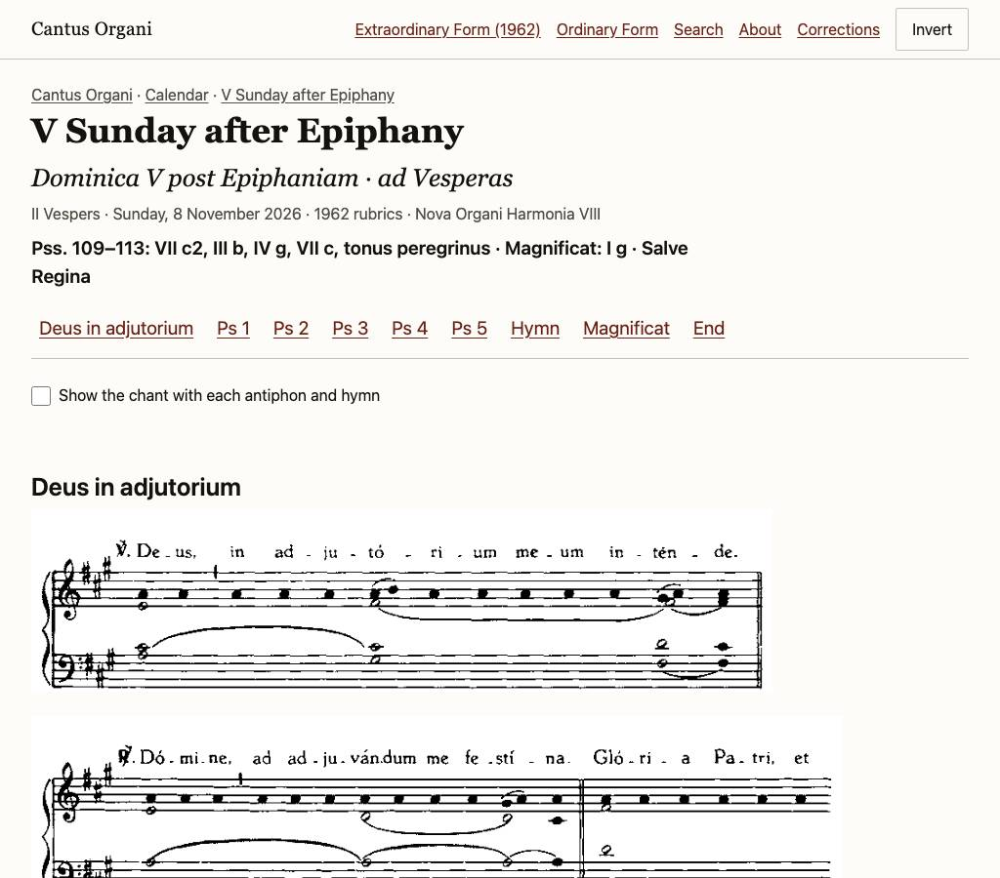
Other views: [390 light](screenshots/vespers-390-light.jpg) · [1024 dark](screenshots/vespers-1024-dark.jpg)

---

## vespers-first

`/vespers/<date>/i/` — `web/src/pages/vespers/[date]/i.astro`, same component as *vespers* — 110 pages. Count: entries in `first_vespers` of `data/vespers/vespers-lineup.json`.

**Purpose.** I Vespers of a I class feast, sung the evening before it.

**Regions.** Identical to *vespers*, with these differences: `meta` reads `I Vespers · sung on the evening of <date>`; `h1` is the feast title; the browser title includes `I Vespers: <feast>`; the quiet `this evening the 1962 rubrics give I Vespers of ...` notice is not shown (it appears on the II Vespers page of the day before). The dated page's `date` is the feast's date, not the evening it is sung.

**Interactive behaviour and states.** As *vespers*.

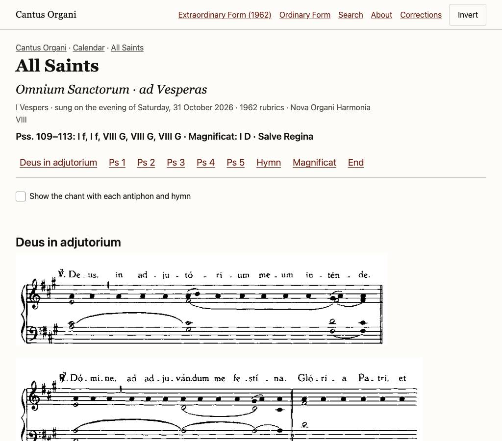
Other views: [390 light](screenshots/vespers-first-390-light.jpg) · [1024 dark](screenshots/vespers-first-1024-dark.jpg)

---

## kyriale

`/kyriale/` — `web/src/pages/kyriale/index.astro` — 1 page.

**Purpose.** Pick one of the Ordinaries of the Mass, a Credo, or another Kyriale chant.

**Regions**
1. Shared nav.
2. Title block: crumb, `h1` Kyriale, one paragraph pointing to the calendar for a date.
3. `nav.toc` (`aria-label="On this page"`): anchor links to each group.
4. One `section` per group from `kyrialeIndex()` (`web/src/lib/indexes.ts`): `Ordinaries of the Mass` (numbered `PieceList`), `Credo`, `Asperges me · Vidi aquam`, `Kyrie ad libitum`, `Gloria, Sanctus, Agnus Dei ad libitum`, `Tones`, and `Other` if anything is left over. Each item: name, subtitle, printed pages.

**Interactive behaviour.** None.

**States.** Groups with no pieces are omitted. The Kyriale is not reached through `[division]`.

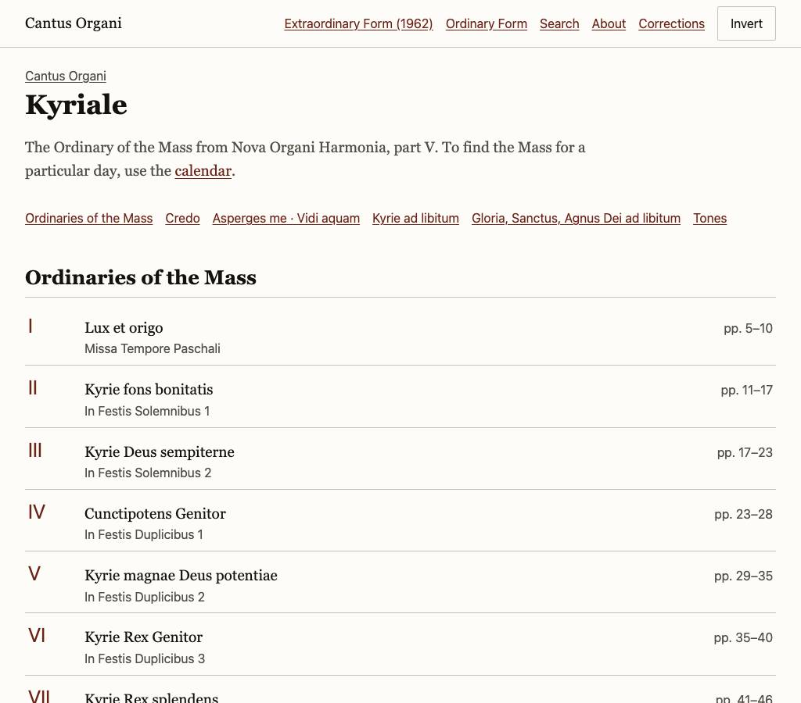
Other views: [390 light](screenshots/kyriale-390-light.jpg) · [1024 dark](screenshots/kyriale-1024-dark.jpg)

---

## kyriale-mass

`/kyriale/<n>/` (n is the lower-case Roman numeral, e.g. `/kyriale/ix/`) — `web/src/pages/kyriale/[mass].astro` — 18 pages. Count: `ordinaryMasses()`, pieces in `data/catalog.json` with `genre: mass_ordinary` and `division: kyriale`.

**Purpose.** Play one Ordinary of the Mass, with its movements and a PDF export.

**Regions**
1. Shared nav and skip link.
2. Header: crumb `Cantus Organi · Kyriale`; `h1 Missa <n>`; the incipit as `lede`; `meta`: title, printed pages, system count.
3. `RecordStatusNotice`.
4. `MovementNav` (`Movements`: Kyrie, Gloria, Credo, Sanctus, Agnus, Ite, plus extra sections) and the chant switch.
5. `ExportBar` (one piece, parts per movement).
6. `TypesetSwitch`, then `SystemStack`.
7. `ChantPair` (always, unlike *piece*).
8. Edit line: `Report an error`, `Edit (editors)`.

**Interactive behaviour and states.** As *piece*, including export, typeset and scan switch, and chant notation. A `/piece/<slug>/` address for the same piece redirects here.

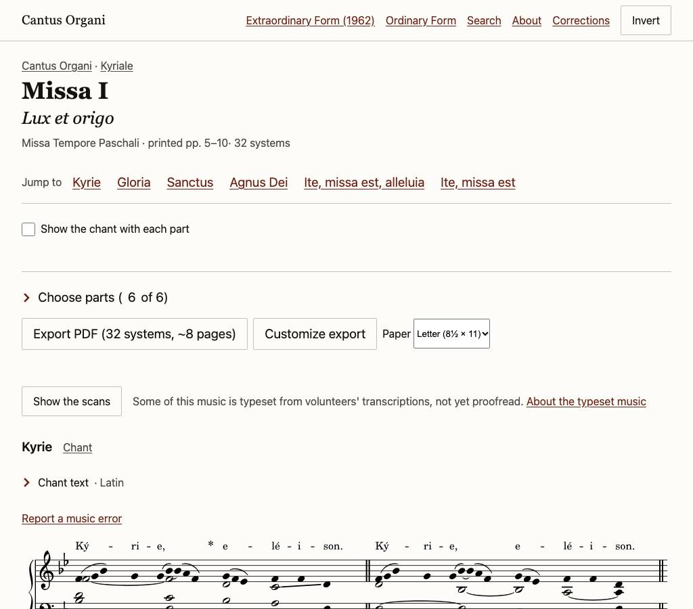
Other views: [390 light](screenshots/kyriale-mass-390-light.jpg) · [1024 dark](screenshots/kyriale-mass-1024-dark.jpg)

---

## ordinary-form

`/ordinary-form/<key>/` — `web/src/pages/ordinary-form/[key].astro` — 193 pages. Count: occasions in `data/ordinary-form-propers.json` (107 weekday, 33 Sunday, 26 privileged, 13 solemnity, 6 feast of the Lord, 4 feast, 3 Triduum, 1 memorial). 190 have mapped chants, 3 are `unmapped`. Optional query: `?cycle=A|B|C&season=advent|christmas|lent|triduum|easter|ordinary`.

**Purpose.** For one Ordinary Form celebration: the chants assigned in the 1974 Graduale Romanum, matched to NOH accompaniment where it exists, with an export.

**Regions**
1. Shared nav and skip link.
2. Header (`data-of-page`): crumb `Cantus Organi · Ordinary Form calendar`; `h1` (occasion title); Latin title (`.latin`); an optional rubric (`rubric_en`); `meta`: `Graduale Romanum (1974) · N assigned chants · M without a NOH match`.
3. Good Friday only: `The organ is silent on Good Friday.` notice linking to `/good-friday/`.
4. Notice: `This page assembles available Nova Organi Harmonia music ...`, with the count of chants not in NOH and `chants not yet mapped.` for unmapped occasions.
5. Note `#of-export-note` (live region): `All years and seasons are shown ...` or `Year B · advent season. ...`.
6. `ExportBar` with the composed piece, `TypesetSwitch`, `MovementNav`, `SystemStack` (the OF figcaption says the music is assembled from NOH sources for the 1974 assignment).
7. Source note: `Chant assignments follow the Graduale Romanum (1974) ...`.

**Interactive behaviour.** `mountOrdinaryFormPage()` (`web/src/lib/ordinaryFormPageClient.ts`) reads `cycle` and `season` from the URL and unticks the export parts that do not apply (`years` and `seasons` on each checkbox), then updates the note. Nothing is stored. Export, switch and chant behave as in *piece*.

**States**
- A chant assigned but not in NOH: a `.notice` line `<section>: Not in Nova Organi Harmonia.` with `Open chant <id> on GregoBase`.
- Unmapped occasion: the `chants not yet mapped.` notice and no music.
- Unknown key: redirect to `/404/` (302).
- Invalid `cycle` or `season` values are ignored (all years, all seasons).

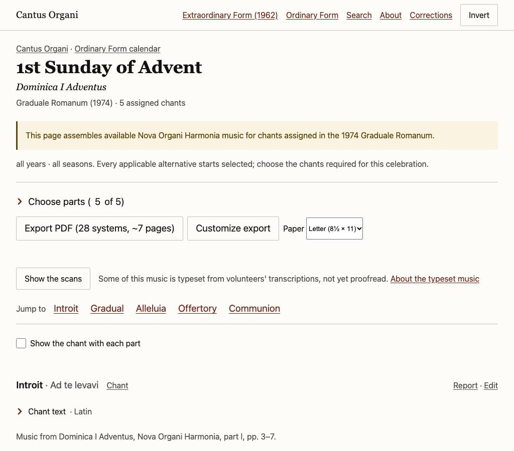
Other views: [390 light](screenshots/ordinary-form-390-light.jpg) · [1024 dark](screenshots/ordinary-form-1024-dark.jpg)

---

## calendar

`/calendar/` — `web/src/pages/calendar/index.astro` — 1 page. Query: `?date=YYYY-MM-DD`.

**Purpose.** Type or step to a date and get the 1962 (Extraordinary Form) Mass for it, with links to the music.

**Regions**
1. Shared nav.
2. Title block: crumb, `h1 Calendar: Extraordinary Form (1962)`, one-line help.
3. Picker form (`#picker`, hidden when printing): date input (min and max from `CALENDAR_SOURCE.years`), buttons `‹ Day`, `Today`, `Next Sunday`, `Day ›`.
4. Result (`article#result`, `aria-live="polite"`), built in the browser: `h2` long date; season line (English · Latin); per celebration (`section.observance`): title, Latin title, colour swatch, colour and rank; a definition list with `Proper` (links to the Mass pieces, `all for this day`), `Ordinary` (suggested Missa, the Kyriale heading, `Also appropriate:` alternatives, note), `Vespers` (if any); then `Commemoration: ...`.
5. Source line: calendar source, licence, rubrics and year range.
6. Two inline JSON blobs: `#day-index` (calendar key to piece links) and `#masses`.

**Interactive behaviour.** Inline script on the page. Buttons step by day, jump to today (the reader's local date) or the next Sunday. Each change calls `history.replaceState` to set `?date=`. Nothing is stored. No custom keyboard handling beyond the native date input and buttons.

**States**
- No scripts: `<noscript>` notice `The calendar needs JavaScript to look up a date.`
- Date outside the year range: `The calendar covers A–B. Choose a date in that range.`
- Day with no Proper of its own: `No Mass of its own: the 1962 rubrics take the Mass of ...` when borrowed; otherwise `No Proper of its own is catalogued for this day.`
- Good Friday: `The organ is silent today.` with a link to the chants page.
- No single Ordinary: `No single Mass is assigned`.
- Every node is built with `textContent` (no `innerHTML`).

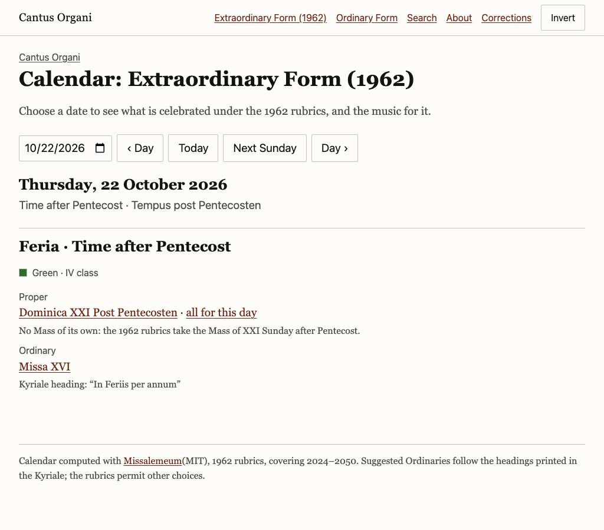
Other views: [390 light](screenshots/calendar-390-light.jpg) · [1024 dark](screenshots/calendar-1024-dark.jpg)

---

## calendar-of

`/calendar/ordinary-form/` — `web/src/pages/calendar/ordinary-form/index.astro` — 1 page. Query: `?date=...&epiphany=jan6|sunday&ascension=thursday|sunday&corpusChristi=thursday|sunday`. Date range 2024–2050.

**Purpose.** The same date lookup for the Ordinary Form, with the Sunday and weekday cycles and the assigned Graduale Romanum chants.

**Regions**
1. Shared nav.
2. Title block (crumb, `h1 Calendar: Ordinary Form`, help line).
3. Picker (as *calendar*) and a feedback line `#date-feedback` (`role="status"`).
4. Result (`#result`, `aria-live="polite"`): date heading; season, `Year A|B|C`, `Weekday Year 1|2`; an optional provisional notice; the occasion (title, Latin, colour and rank, optional rubric); `Proper chants` list, each linking to the NOH accompaniment or, if there is none, `Not in Nova Organi Harmonia` linking to GregoBase; `View accompaniments for this occasion` (link to the *ordinary-form* page with `?cycle=&season=`), or two `View ... accompaniments` links where local calendars differ; vigil, readings-chants and Christmas Mass option links.
5. `Browse Ordinary Form chant sets` disclosure: static links in three groups (Sundays, feasts and solemnities; seasonal weekdays; vigils and Christmas Mass choices), so every occasion page is reachable without JavaScript.
6. Source line.

**Interactive behaviour.** `web/src/lib/ordinaryFormCalendarClient.ts` reads `#of-occasion-index` JSON. Date changes by the buttons `push` history (Back works); the initial load `replace`s it. Prev and next are disabled at the range ends. `popstate` re-renders.
- Transfers of Epiphany, Ascension and Corpus Christi are read from the URL, else from `localStorage` key `cantusorgani.ordinary-form.settings.v1`. There is no control on the page that sets them, and nothing in the site writes that key, so today only the URL carries them.

**States**
- No scripts: `<noscript>` notice (the browse list still works).
- Invalid date in the URL or the input: `aria-invalid` on the input and `Enter a valid date from 2024-01-01 to 2050-12-31.` in the feedback line.
- Out of range: `The Ordinary Form calendar covers 2024–2050. Choose a date in that range.`
- Occasion unmapped: `chants not yet mapped`; no parts: `No chant assignment is recorded for this occasion.`
- Ordinary Time weekday: `the chants of this week's Sunday Mass may be used` (or the preceding Sunday), with a link. Seasonal weekday without its own set: `the chants of the Sunday are repeated on this weekday`. Triduum: `No Mass is celebrated during the day.`

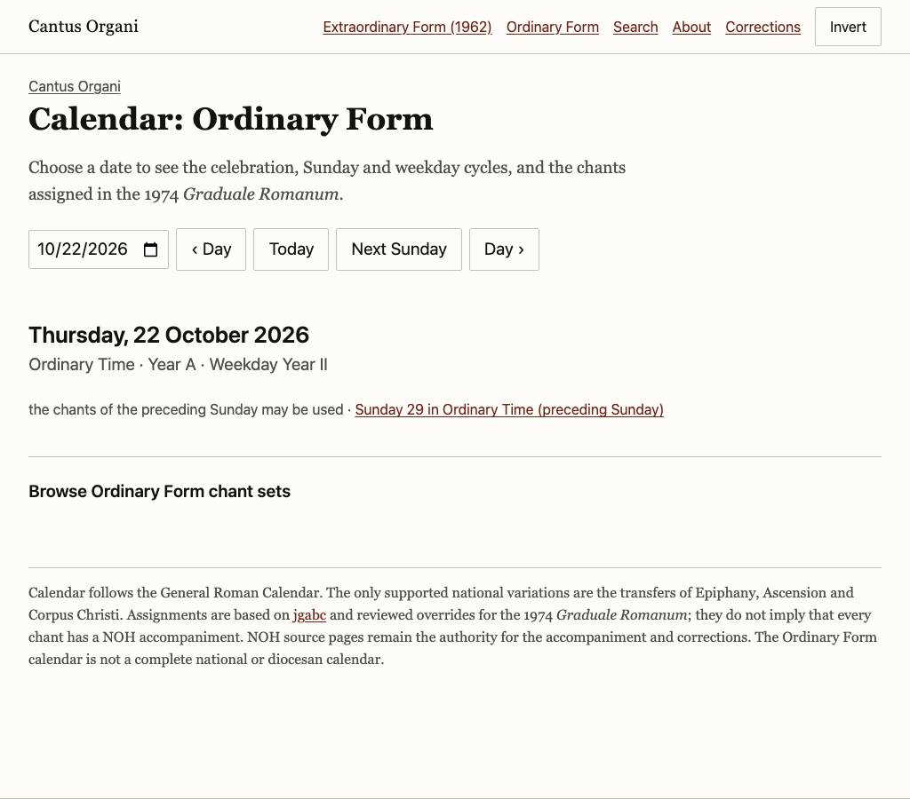
Other views: [390 light](screenshots/calendar-of-390-light.jpg) · [1024 dark](screenshots/calendar-of-1024-dark.jpg)

---

## good-friday

`/good-friday/` — `web/src/pages/good-friday/index.astro` — 1 page. Data: `data/good-friday.json` through `web/src/lib/goodFriday.ts`.

**Purpose.** Give the chants of Good Friday for both calendars. The organ is silent that day, so there is no score.

**Regions**
1. Shared nav and skip link (`#chants`).
2. Title block: crumb with links to both calendars; `h1 Good Friday`; Latin `lede`; a `The organ is silent` notice; `nav.rites` (`aria-label="Rite"`) with an anchor per rite.
3. `#chants`: per rite an `h2`, a subtitle (`subtitle · edition`), per section an `h3`, per item an `h4` with a `GregoBase <id>` link, a source line, an optional note, and the chant notation box.
4. Attribution: `Chant notation from GregoBase (CC0), drawn with Exsurge.`

**Interactive behaviour.** `initChantNotation({ always: true })` draws every box when it nears the viewport. No switch, no storage.

**States**
- No scripts: `<noscript>` text `The chant is drawn in the browser; follow the GregoBase link to see it without JavaScript.`
- Item with no notation in `data/chants.json`: `This chant's notation is not published here; follow the GregoBase link.`
- Draw failure: `The chant could not be drawn here ...` (as *piece-chant*).

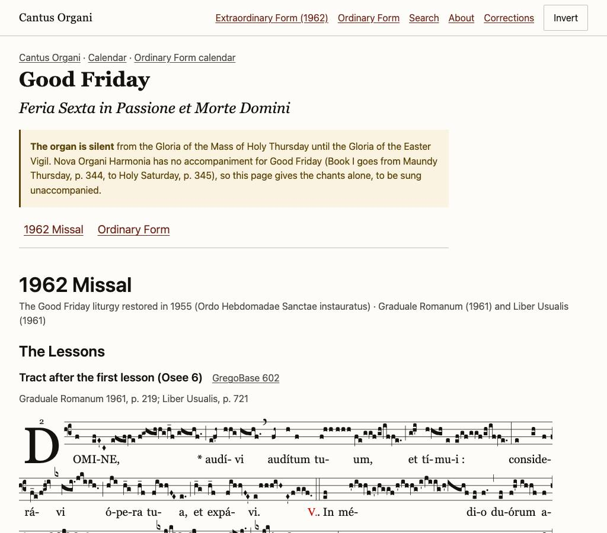
Other views: [390 light](screenshots/good-friday-390-light.jpg) · [1024 dark](screenshots/good-friday-1024-dark.jpg)

---

## hymns

`/hymns/` — `web/src/pages/hymns/index.astro` — 1 page. The list length is `hymnIndex().length` (`web/src/lib/catalog.ts`), printed on the page and on the home card; it is not counted here.

**Purpose.** Find a hymn setting across the books, alphabetically.

**Regions**
1. Shared nav.
2. Title block: crumb; `h1 Hymns Hymni`; explanation; a note on GregoBase checking; `N printed settings` with a link to `/varia/`.
3. `ul.hymns`: per setting, the title (link to the piece, with `#anchor` when it is a part), `NOH <part> · p. N` (and the piece title when it is not a plain hymn piece), and a `GregoBase` link when a pairing exists (from `web/src/lib/hymnpairings.ts`).

**Interactive behaviour.** None. There is no filter or search on this page.

**States**
- Pairing `unverified`: the GregoBase link reads `GregoBase · pairing needs review`.
- Pairing `unresolved`: `No matching GregoBase chant found`.
- No pairing: no GregoBase link.

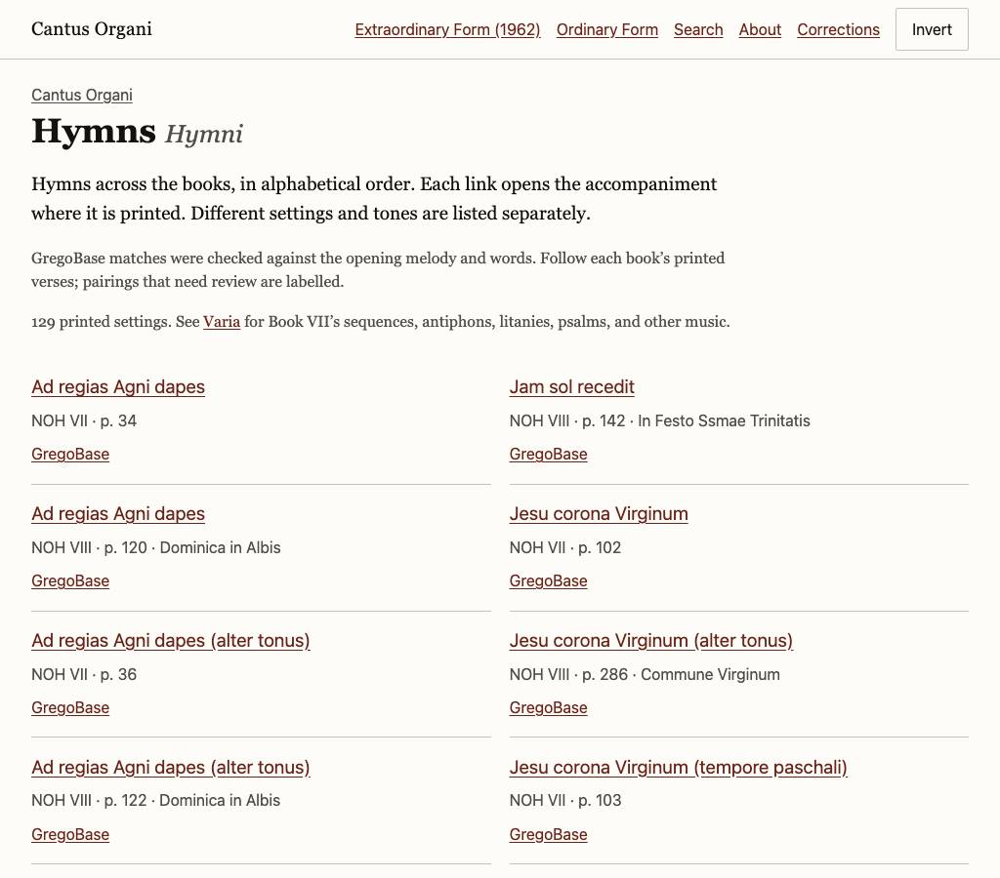
Other views: [390 light](screenshots/hymns-390-light.jpg) · [1024 dark](screenshots/hymns-1024-dark.jpg)

---

## search

`/search/` — `web/src/pages/search.astro` — 1 page. Noindex, and skipped by the site search itself.

**Purpose.** Find a piece by chant words, title, Mass number or mode.

**Regions**
1. Shared nav.
2. Title block: `h1 Search`, label and a `type="search"` input (`#q`, `autofocus`, placeholder `Et vitam venturi · Missa IX · mode II`).
3. `#results` (`aria-live="polite"`).
4. `#fallback`: `Ordinarium Missae`, the 18 Masses (numeral, incipit, page range), shown when the box is empty.

**Interactive behaviour.** Script on the page. Typing is debounced 120ms. The Pagefind bundle (`/pagefind/pagefind.js`, built after the site) loads on first use. Up to 25 results show: title (`textContent`) and an excerpt with `<mark>` rebuilt from the escaped text. The query is not put in the URL and nothing is stored. Native keyboard only.

**States**
- Empty query: results cleared, fallback list shown.
- Index missing (dev server): `Search runs on the built site. Run pnpm build and preview it.`
- No match: `No match for "<query>". Try words from a chant (Et vitam venturi), a Mass number (Missa IX), or a mode (mode II).`
- Out-of-date responses are dropped (`revision` counter).

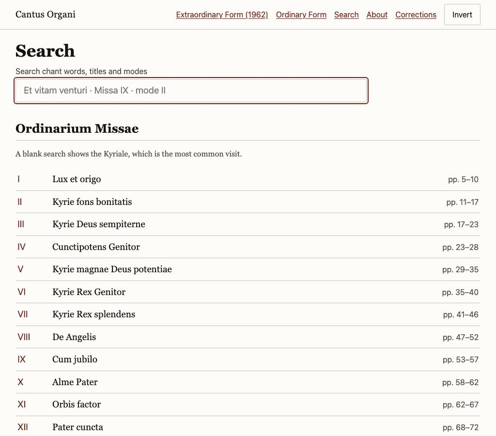
Other views: [390 light](screenshots/search-390-light.jpg) · [1024 dark](screenshots/search-1024-dark.jpg)

---

## corrections

`/corrections/` — `web/src/pages/corrections/index.astro` — 1 page. Noindex. Query: `?target=<kind>:<id>`, `?piece=<slug>`, `?field=`, `?seen=<hash>` (for typeset reports).

**Purpose.** A reader reports an error in a title, mode, page range, chant or typeset music, and sees the public queue.

**Regions**
1. Shared nav.
2. Title block: `h1 Corrections`, explanation, link to the log.
3. A `Corrections are not configured in this build.` notice when `CORRECTIONS_ENDPOINT` or `TURNSTILE_SITE_KEY` is missing (`web/src/lib/config.ts`).
4. Form (`#correction-form`): `Reporting on: <label> · choose something else` (when deep-linked); `Which piece?` select (all 576 pieces); `What is wrong?` select (Title, Incipit, Mode, Genre, Printed pages, A part is missing or mislabelled), a hint and a `Now: ...` line; `What should it be?` text (max 160); `Anything else?` textarea (optional, max 2000, never published); a Cloudflare Turnstile widget; `Send correction`; a live status line.
5. `Recent corrections` (`#queue-list`): a table of Piece or item, Field, Proposed, Status (`accepted`/`resolved` styled), with `Published change` commit links.

**Interactive behaviour**
- Deep links from `Report` links set the target and swap the field list by kind (part, pairing, vespers; `typeset` swaps the value box for a `Kind of problem` select from `MUSIC_ISSUES`). Labels come from `/corrections/targets.json`.
- Submit POSTs JSON to `CORRECTIONS_ENDPOINT` with the Turnstile token; the widget resets afterwards. Nothing is stored in the browser.
- The queue loads on open and after a successful send.

**States**
- Not configured: submit disabled, no Turnstile.
- Mode on a Proper: the option is disabled and `A Proper has no single mode: each of its parts has its own. Choose another field.`
- Validation messages: `Choose which piece the correction applies to.`, `Say what the value should be.`, `Please complete the anti-spam check just above the button.`
- Send results: `Sending…`; `Thank you. Your correction is in the queue for review.`; duplicate `That correction is already in the queue — thank you.`; 503 `Corrections are paused ...`; 429 the server's message; other errors `Could not send the correction (N).`; network `Could not reach the corrections service. Nothing was sent.`
- Unknown deep-link target: `We couldn't find that item; choose it below.`; typeset link without a valid hash: `This music report needs the drawing version. ...` and submit disabled.
- Queue: `Loading…`, `No corrections have been submitted yet.`, `The corrections queue is not available in this build.`, `The corrections queue could not be loaded just now.`

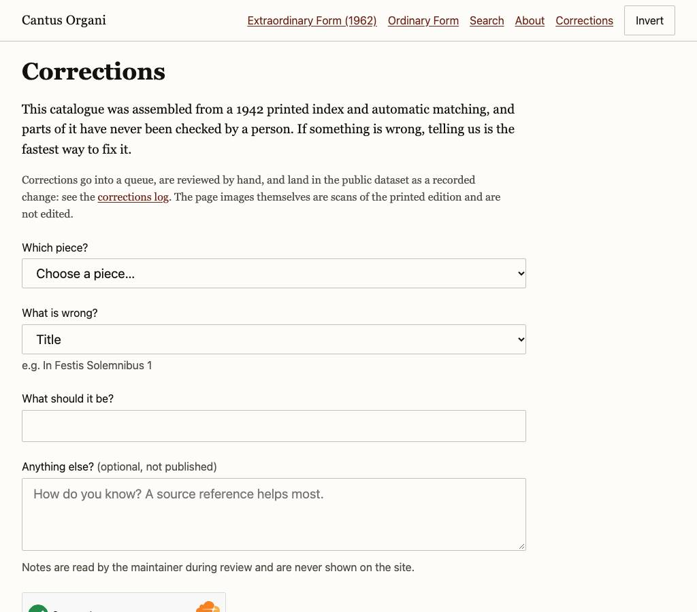
Other views: [390 light](screenshots/corrections-390-light.jpg) · [1024 dark](screenshots/corrections-1024-dark.jpg)

---

## corrections-log

`/corrections/log/` — `web/src/pages/corrections/log/index.astro` — 1 page. Data: `data/corrections-log.json` through `web/src/lib/correctionsLog.ts`.

**Purpose.** Show every accepted correction, newest first, so the site reads as a corrected edition.

**Regions**
1. Shared nav.
2. Title block: crumb `Cantus Organi · Corrections`, `h1`, explanation with links to the form.
3. A scrolling table (`.scroll > table.log`): Date, What (linked when `href` exists), Changed, From, To, Reported by (`a reader` or `an editor`).

**Interactive behaviour.** None.

**States.** Empty log: `No corrections yet.` Rows with no page link show plain text.

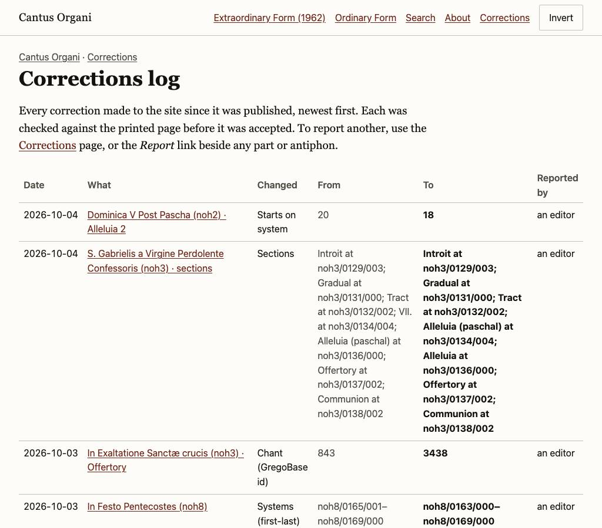
Other views: [390 light](screenshots/corrections-log-390-light.jpg) · [1024 dark](screenshots/corrections-log-1024-dark.jpg)

---

## about

`/about/` — `web/src/pages/about.astro` — 1 page.

**Purpose.** Say what the site is for, how to use it at the organ, its limits and its sources.

**Regions**
1. Shared nav.
2. One long `.prose` column: crumb, `h1`, `lede`, then sections with anchors: `#what`, `#how` (Find the music for a day, Vespers, Browse the books, At the organ), `#limits`, `#corrections`, `#typeset`, `#sources` (a definition list of credits and licences).
- Live numbers: the piece count (`allPieces().length`) and the first and last Vespers years (`allLineups()`).
- Other pages link to anchors here: `/about/#sources` (footer), `/about/#typeset` (typeset notes), `/about/#corrections` (admin).

**Interactive behaviour.** None.

**States.** If there are no Vespers lineups the year range prints empty. No other conditional content.

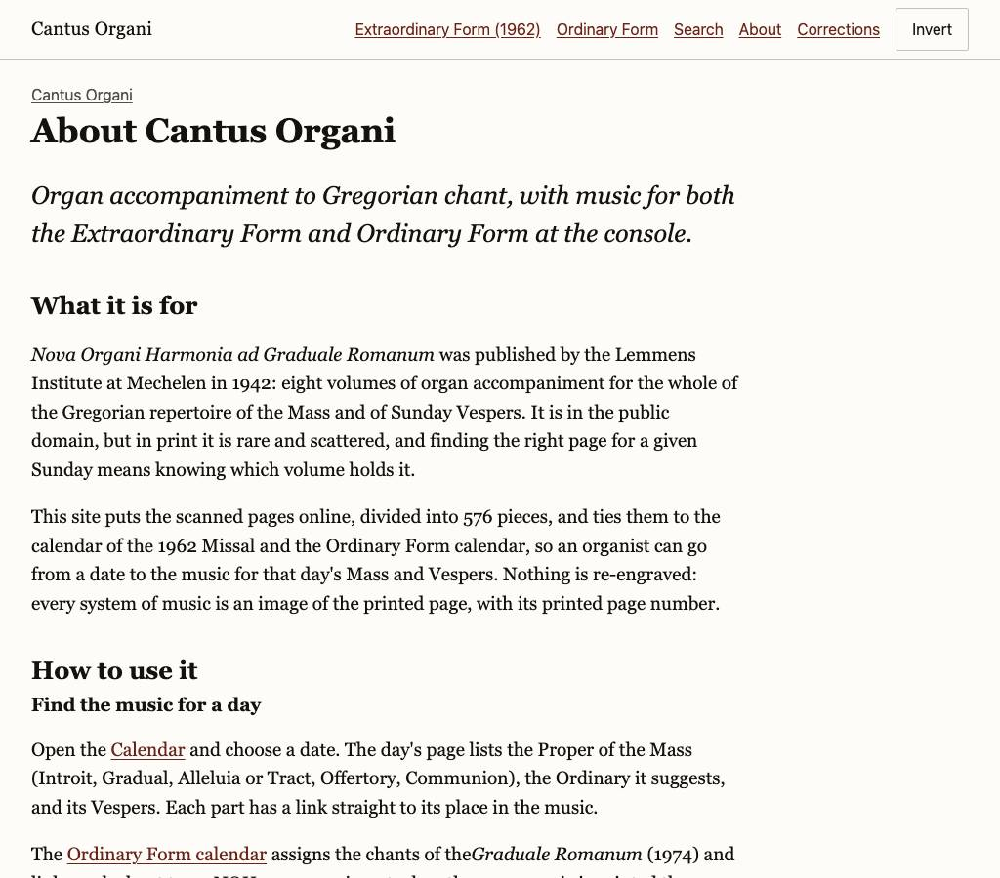
Other views: [390 light](screenshots/about-390-light.jpg) · [1024 dark](screenshots/about-1024-dark.jpg)

---

## not-found

`/404` — `web/src/pages/404.astro` — 1 page. Noindex.

**Purpose.** Tell the reader the address leads nowhere and offer three ways on.

**Regions.** Shared nav; `404 · Page not found`; `h1 Music not found`; one sentence; three links (Search; Find music for a date; Browse the books from the home page). Shared footer.

**Interactive behaviour and states.** None. The *ordinary-form* page redirects here when a key is unknown.

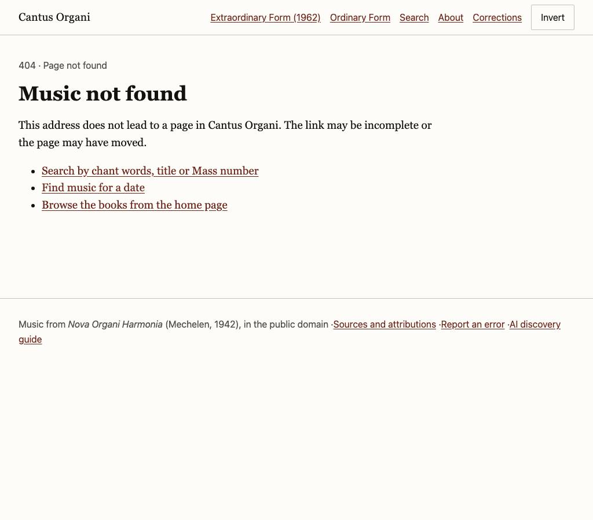
Other views: [390 light](screenshots/not-found-390-light.jpg) · [1024 dark](screenshots/not-found-1024-dark.jpg)

---

## Admin screens

Six screens under `/admin/`, all noindex and behind Cloudflare Access. Screenshots need a signed-in local admin; see `docs/ADMIN-SETUP.md`. A usability review with findings per screen is in `docs/ADMIN-UX-REVIEW.md`; this section records structure only.

Common to all: the shared Layout (with `noindex`), then `AdminNav` (`web/src/components/AdminNav.astro`): `Admin`, `Review (n)`, `Typeset music (n)`, `Make a correction`, and a `N ready to publish` link that shows when something is approved and waiting. Counts come from `/admin/api/summary` (`web/src/lib/admin/summaryClient.ts`). Status lines are `role="status"`. Drafts are kept in `sessionStorage` under `admin:<key>` (`drafts` in `web/src/lib/admin/client.ts`) and survive a sign-in round trip; an expired session shows `Your session ended. Sign in again — your unsaved changes are kept.` Code is in `web/src/lib/admin/`; API in `web/functions/`.

### /admin/ (admin home)

File: `web/src/pages/admin/index.astro`. 1 page.
- **Purpose.** See what is waiting on every list, answer readers' reports, and publish.
- **Regions.** `What's waiting` table (Ready to publish with `Publish changes`; Readers' reports; Review fix and check counts; Typeset matches, errors, proofreading; melody audit totals; Custom export paused; Last published); a `How publishing works` disclosure; `Custom export paused: MEI re-review needed` table (only when `EXPORT_PAUSED` is not empty); `Readers' reports`; `Approved, waiting to publish`; `Publishing`; `History` with `Show the last 100`.
- **Behaviour.** Everything loads from `/admin/api`. `Publish changes` sends one pull request to GitHub (self-merges after checks unless it moves systems between pieces or holds 25 changes or more).
- **States.** `Loading…` placeholders in the table and report list; the publish button is disabled until something is approved; the paused section is absent when none.

### /admin/review/

File: `web/src/pages/admin/review/index.astro`. 1 page.
- **Purpose.** Confirm, correct or skip each item the pipeline was unsure of, against its scan.
- **Regions.** `How Review works` disclosure; filters (radio group by `GROUP_LABELS`, Volume, Kind, `Show what is already done`); `What is waiting` breakdown; a shown-count line; the item cards (heading, instruction `look`, detail, scan figures, then the actions `Looks right`-style confirm button, `Correct`, `Edit the sections`, `Skip with a note…`, `Open the page`); a `Things the site can't act on (N)` section of compact tables.
- **Behaviour.** `web/src/lib/admin/reviewClient.ts` posts to `/admin/api`; Enter in the skip-note box submits. Filter state can be set by `?group=` and `?kind=`.
- **States.** Per-item state line (`aria-live`); a `none` panel with `Clear the filters`, next-group and `Back to the Admin page` buttons when the filter shows nothing. The old `/admin/parts/` address redirects here (`web/public/_redirects`).

### /admin/edit/

File: `web/src/pages/admin/edit/index.astro`. 1 page.
- **Purpose.** An editor's own correction to a piece, a part or a Vespers item, approved straight away.
- **Regions.** Back-to-Review link (when opened from Review); target line (`Correcting: ...`, `Change`, link to the full sections editor); piece select; part select (when relevant); field select; `Now:` line; value input; scans of the systems concerned; `Why?` note; `Approve this correction`; status.
- **Behaviour.** Opened as `/admin/edit/?target=...` (and `&from=review&item=...`). Draft text survives a reload.
- **States.** `Loading…` in the piece select; save hint text; session-ended notice.

### /admin/sections/

File: `web/src/pages/admin/sections/index.astro`. 1 page. Opened as `?piece=<slug>` (and `&report=<id>`).
- **Purpose.** Edit a Proper's whole list of sections beside its scans.
- **Regions.** Title and intro; a hidden hint for pieces with movements; two columns: `The list` (rows, `Add a section printed elsewhere`, `Why?`, change summary, `Approve this list`, `Start again from the published list`) and `The piece's systems` (each system with `Start a section here`).
- **Behaviour.** Logic in `web/src/lib/admin/sectionsEditor.ts` (insert, move, rename, kind, chant). Saving approves one correction `sections:<slug>`.
- **States.** The layout is hidden until the piece loads; a pending-note line when a list is already approved and waiting.

### /admin/typeset/

File: `web/src/pages/admin/typeset/index.astro`. 1 page.
- **Purpose.** Work through the three queues of volunteer LilyPond transcriptions.
- **Regions.** Melody-audit totals; filters (queue radios: Matches, Errors, Proofreading; Volume; `Show what is already done`; `Show the chant`); one section per queue with its intro; cards with the LilyPond drawing, candidates with their scans and melody match, error line and source excerpt, `Edit the source`, and the queue's buttons.
- **Behaviour.** `web/src/lib/admin/typesetClient.ts` and `reviewClient.ts`; chant notation via `initChantNotation`. `?queue=matches|errors|proofreading` selects a queue.
- **States.** A conflict notice on a card when two files claim one part; `no chant to compare` when no melody reference; a proofreading progress line; per-card state line.

### /admin/typeset/edit/

File: `web/src/pages/admin/typeset/edit.astro`. 1 page. Opened as `?file=<name>`.
- **Purpose.** Edit a LilyPond source file, preview its drawing, and approve the edit.
- **Regions.** Intro; scan context; `LilyPond source` (CodeMirror editor) with a problems list; `Music preview`; buttons `Save draft`, `Preview draft`, `Reload saved draft`; a `Compare versions` conflict panel (latest repository source, saved draft, `Use the latest base for my editor text`); an `Approved source edit` panel; `Public reason`; `Approve this edit`.
- **Behaviour.** Drafts are saved server-side (private); the preview runs the typeset preview workflow (`web/src/lib/admin/typesetPreview.ts`).
- **States.** `Loading source…`; controls hidden until loaded; source problems list from `sourceCheck.ts`; conflict and approved-snapshot panels appear only when they apply.
